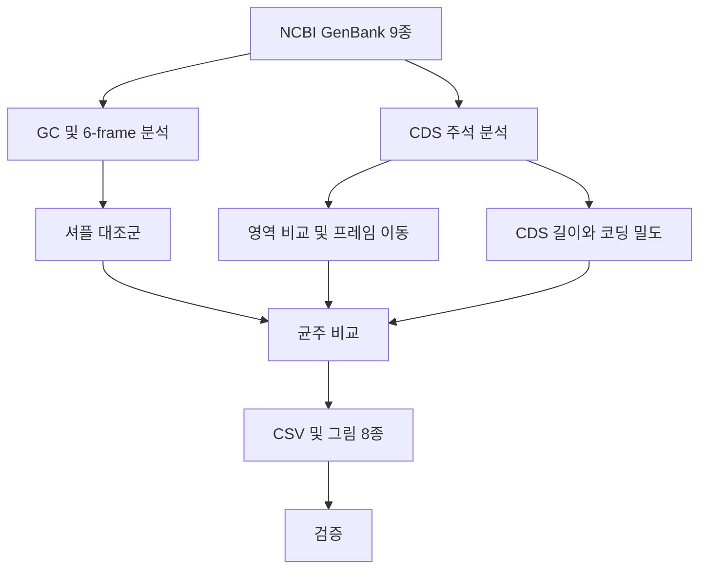

# 세균의 GC 함량과 코딩 영역 특성에 따른 종결 코돈 분포 비교 분석

**Comparative Analysis of Stop Codon Distribution in Relation to GC Content and Coding Region Characteristics in Bacterial Genomes**

충남대학교 생명정보융합학과 · 생명정보학 컴퓨팅 기말 대체 프로젝트

`Python` · `Biopython` · `Matplotlib` · `NCBI RefSeq`

> **검증 범위:** 최종 발표용 코드로 학생이 제공한 실제 유전체 9종을 ChatGPT 실행 환경에서 1회 분석하였다. 29개 검사 및 8개 그림 생성 검사가 통과하였다. 학교 서버의 최종 소스와 동일한지는 미확인이다. 합성 데이터의 재실행은 일치했으나 실제 9종의 두 번째 실행 및 GitHub 새 다운로드 검증은 아직 필요하다. 원본 파일과 일부 출력 파일은 별도 웹 업로드가 필요하다.

## Contents

- [연구 목적](#연구-목적)
- [데이터 준비](#데이터-준비)
- [처음부터 끝까지 실행](#처음부터-끝까지-실행)
- [전체 코드](#전체-코드)
- [실제 분석 결과](#실제-분석-결과)
- [검증 및 한계](#검증-및-한계)
- [LLM 학습 기록](docs/LLM_learning_log.md)
- [초기 2종 분석](docs/initial_analysis.md)

## 연구 목적

GC 함량과 6-frame 종결 코돈 간격의 관계를 탐색하고, 염기 조성을 보존한 셔플 대조군, CDS·비CDS 영역, 실제 CDS 길이, 코딩 밀도와 읽기 틀 이동을 비교한다.



## 데이터 준비

[9종 메타데이터](strains.csv) · [입력 파일 안내](data/README.md)

| Species | RefSeq accession |
|---|---|
| S_coelicolor | [NC_003888.3](https://www.ncbi.nlm.nih.gov/nuccore/NC_003888.3) |
| P_aeruginosa | [NC_002516.2](https://www.ncbi.nlm.nih.gov/nuccore/NC_002516.2) |
| C_crescentus | [NC_002696.2](https://www.ncbi.nlm.nih.gov/nuccore/NC_002696.2) |
| E_coli | [NC_000913.3](https://www.ncbi.nlm.nih.gov/nuccore/NC_000913.3) |
| C_difficile | [NC_009089.1](https://www.ncbi.nlm.nih.gov/nuccore/NC_009089.1) |
| M_tuberculosis | [NC_000962.3](https://www.ncbi.nlm.nih.gov/nuccore/NC_000962.3) |
| M_leprae | [NC_002677.1](https://www.ncbi.nlm.nih.gov/nuccore/NC_002677.1) |
| R_prowazekii | [NC_000963.1](https://www.ncbi.nlm.nih.gov/nuccore/NC_000963.1) |
| B_aphidicola | [NC_002528.1](https://www.ncbi.nlm.nih.gov/nuccore/NC_002528.1) |

각 accession의 실제 GenBank를 `data/NC_*.gb`에 저장한다. FASTA는 별도 시연용이다. 원본 18개는 아직 웹 업로드가 필요하다. 기존 초기 2종 압축 파일과 혼동하지 않는다.

## 처음부터 끝까지 실행

Linux, WSL 등 Bash 환경에서 저장소를 내려받거나 전체 코드 튜토리얼의 코드를 파일별로 작성한다.

```bash
git clone https://github.com/elin9785-afk/yujikang.git
cd yujikang
python3 -m venv .venv
source .venv/bin/activate
python -m pip install -r requirements-verified.txt
```

검증 환경: Python 3.13.5, Biopython 1.86, Matplotlib 3.10.8.

### 1. 단위 검사와 작은 예제

```bash
python test_all.py
python demo.py
bash run_all.sh demo_strains.csv demo_data demo_results 3
bash run_all.sh demo_strains.csv demo_data demo_repeat 3
diff -r demo_results demo_repeat && echo 'Reproducibility PASS'
```

### 2. 실제 9종 분석

원본 파일이 모두 준비되면 실행한다. 원본 체크섬 파일도 함께 업로드한 경우 먼저 검사한다.

```bash
sha256sum -c data/input_sha256.txt
bash run_all.sh strains.csv data reproduced_results 3
```

셔플 3회, 난수 seed 42. 새로운 출력 폴더를 사용한다.

### 3. 새로운 서열 분석

```bash
python analyze.py --fasta-only data/NC_009089.1.fasta --out live
head -n 7 live/fasta_frames.csv
```

다른 DNA FASTA도 입력할 수 있다. FASTA-only는 GC 및 6-frame 분석만 제공한다. 주석 기반 분석은 GenBank와 메타데이터를 사용한다.

```bash
cat > custom_strains.csv <<'CSV'
strain,file,accession,lifestyle,table
new_bacteria,new_bacteria.gb,,Unknown,11
CSV
bash run_all.sh custom_strains.csv data custom_results 3
```

한 GenBank에 여러 레코드가 있으면 accession을 명시한다.

## 전체 코드

**[전체 소스 원문 실습 튜토리얼 (Step 01–10)](docs/full_code_tutorial.md)** — 각 파일의 실제 검증 버전 전체를 생략 없이 공개한다.

| 순서 | 파일 | 역할 |
|---|---|---|
| 01 | [requirements.txt](requirements.txt) | 라이브러리 설정 |
| 02 | [strains.csv](strains.csv) | 9종 메타데이터 |
| 03 | [dna_tools.py](dna_tools.py) | GC·6-frame·셔플·CDS 계산 함수 |
| 04 | [analyze.py](analyze.py) | GenBank 및 FASTA 입력과 분석 |
| 05 | [compare.py](compare.py) | 균주 비교 및 순위상관 |
| 06 | [plot.py](plot.py) | 그래프 생성 |
| 07 | [test_all.py](test_all.py) | 29개 검사 |
| 08 | [demo.py](demo.py) | 합성 유전체 생성 |
| 09 | [check_output.py](check_output.py) | 출력 검증 |
| 10 | [run_all.sh](run_all.sh) | 전체 분석 실행 |

## 실제 분석 결과

[9종 요약 CSV](results/strain_summary.csv) · [상관분석](results/correlations.csv) · [영역 분석](results/regions.csv) · [프레임 이동](results/shifts.csv) · [실제 실행 로그](verification/real_run.txt) · [FASTA 시연](verification/fasta_frames.csv)

| Species | GC (%) | 평균 종결 간격 (codons) |
|---|---:|---:|
| S_coelicolor | 72.12 | 84.18 |
| P_aeruginosa | 66.56 | 61.82 |
| C_crescentus | 67.21 | 53.82 |
| E_coli | 50.79 | 24.83 |
| C_difficile | 29.06 | 12.57 |
| M_tuberculosis | 65.61 | 52.28 |
| M_leprae | 57.80 | 31.70 |
| R_prowazekii | 29.00 | 11.60 |
| B_aphidicola | 26.31 | 12.22 |

GC 함량과 평균 종결 간격의 Spearman ρ = 0.9667 (n=9). 탐색적 상관관계이다.

전체 출력은 frames.csv, genes.csv, regions.csv, shifts.csv, shuffle.csv, correlations.csv, lifestyle.csv, strain_summary.csv, run_info.json, figures/ (8종)이며, 아직 공개되지 않은 원본 출력 파일은 웹 업로드로 추가한다.

## 검증 및 한계

- 29개 검사 통과, 실제 9종 1회 분석 및 8개 그림 생성 검사 통과.
- 동일 조건 합성 데이터 재실행 결과 일치.
- 실제 9종 재실행 비교, 학교 서버 소스 일치 여부 및 GitHub에서 내려받은 코드 검증은 미완료.
- 6-frame 간격은 두 종결 사이 내부 코돈 수이며 초기 두 종 코드 정의와 다르다.
- CDS 점유율은 비-pseudo CDS 좌표 합집합이며 비CDS는 비기능 DNA와 동일하지 않다.
- 셔플은 단일 염기 조성을 보존하지만 코돈 사용·이염기 조성은 보존하지 않는다.
- 9종은 대표 표본이며 계통 보정 및 유의성 검정 없이 기술적으로 비교한다.

[상세 계산 정의와 원본 기술 문서](docs/verified_source_readme.md)

## 학습 및 참고자료

[LLM 활용 학습 기록](docs/LLM_learning_log.md) · [초기 분석 기록](docs/initial_analysis.md) · [NCBI](https://www.ncbi.nlm.nih.gov/nuccore/) · [Biopython](https://biopython.org/docs/latest/Tutorial/) · [Matplotlib](https://matplotlib.org/stable/) · [JunKimLabTutorial](https://github.com/JunKimCNU/JunKimLabTutorial) (구성 참고)
