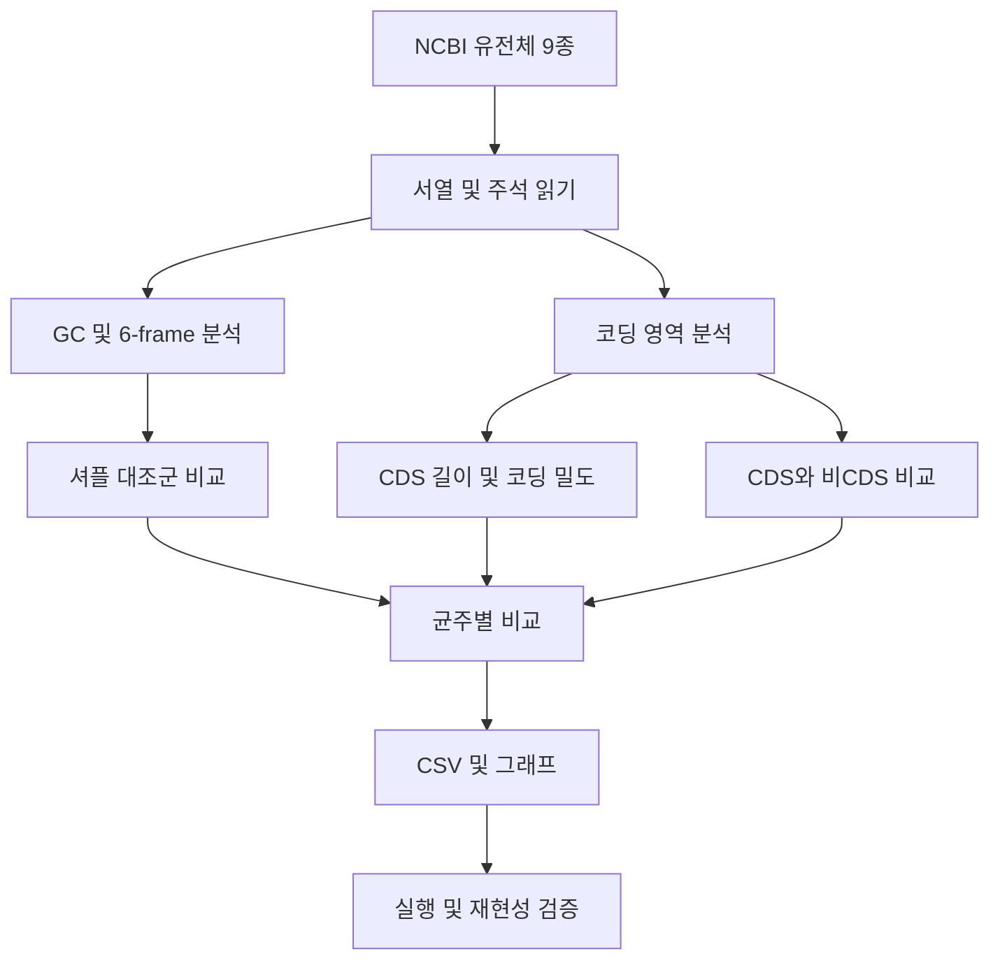

# 세균의 GC 함량과 코딩 영역 특성에 따른 종결 코돈 분포 비교 분석

**Comparative Analysis of Stop Codon Distribution in Relation to GC Content and Coding Region Characteristics in Bacterial Genomes**

충남대학교 생명정보융합학과 · 생명정보학 컴퓨팅 기말 대체 프로젝트

`Python` · `Biopython` · `NCBI` · `Comparative genomics`

> 초기 2종 실습의 실제 공개 코드와 기존 결과를 먼저 기록한다. 9종 확장 분석은 학교 서버에서 사용한 최종 소스 원문과 결과를 확인한 후 추가한다. 아래는 현재 확인 가능한 범위이며 최종 재현성 검증 완료를 뜻하지 않는다.

## Contents

1. [연구 배경](#1-연구-배경)
2. [입력 데이터](#2-입력-데이터)
3. [실행 환경 및 서열 준비](#3-실행-환경-및-서열-준비)
4. [초기 분석 코드 전체](#4-초기-분석-코드-전체)
5. [실행과 결과 확인](#5-실행과-결과-확인)
6. [9종 확장 분석](#6-9종-확장-분석)
7. [재현성 및 해석의 한계](#7-재현성-및-해석의-한계)
8. [참고자료](#8-참고자료)

## 1. 연구 배경

GC 함량이 다른 세균에서 종결 코돈 분포가 어떻게 달라지는지 비교하고, 염기 배열과 실제 코딩 영역의 특성도 관련되는지 탐색한다. 초기 분석은 저GC *Clostridioides difficile*과 고GC *Streptomyces coelicolor*를 대상으로 한다.

## 2. 입력 데이터

- [저GC 원본 NCBI 압축 데이터](ncbi_dataset.zip%20%EC%A0%80gc)
- [고GC 원본 NCBI 압축 데이터](ncbi_dataset.zip%20%EA%B3%A0%20gc)
- [초기 분석 원본 코드](step1_gc_6frame.py)
- [초기 분석 기존 결과](initial_summary.csv)

압축 자료는 DNA 입력 데이터이며 코드 압축본이 아니다. 압축 내부의 정확한 accession과 파일 구성은 아직 확인되지 않았다.

## 3. 실행 환경 및 서열 준비

Python 3과 Biopython을 설치한다. 아래는 Bash 환경에서의 재현 예시이며 원래 학교 서버에서 입력한 명령 전체를 확인한 것은 아니다.

```bash
python3 -m venv .venv
source .venv/bin/activate
python -m pip install biopython
```

원본 압축 자료에서 유전체 nucleotide FASTA를 추출한다. 해당 서열을 아래 두 이름으로 작업 폴더에 배치한다.

| 파일명 | 대상 |
|---|---|
| C_diff_genome.fna | C. difficile |
| S_coel_genome.fna | S. coelicolor |

## 4. 초기 분석 코드 전체

### Step 1. GC 함량 및 6-frame 종결 거리 분석

아래는 저장소의 [step1_gc_6frame.py](step1_gc_6frame.py) 원문 전체이다. 코드 다운로드 없이 복사하여 같은 이름으로 저장할 수 있다.

```python
import csv
from Bio import SeqIO

STOP_CODONS = {"TAA", "TAG", "TGA"}

def get_gc_and_6frame_stops(fasta_file):
    total_gc, total_len = 0, 0
    stop_dists = []

    for record in SeqIO.parse(fasta_file, "fasta"):
        seq = record.seq.upper()
        s_str = str(seq)
        total_gc += s_str.count('G') + s_str.count('C')
        total_len += len(s_str)

        for strand in [seq, seq.reverse_complement()]:
            st = str(strand)
            for frame in range(3):
                count = 0
                for i in range(frame, len(st) - 2, 3):
                    codon = st[i:i+3]
                    if set(codon) - {'A', 'T', 'G', 'C'}:
                        count = 0
                        continue
                    count += 1
                    if codon in STOP_CODONS:
                        stop_dists.append(count)
                        count = 0

    gc_pct = round((total_gc / total_len) * 100, 2)
    mean_dist = round(sum(stop_dists) / len(stop_dists), 2)
    return total_len, gc_pct, mean_dist

c_len, c_gc, c_dist = get_gc_and_6frame_stops("C_diff_genome.fna")
s_len, s_gc, s_dist = get_gc_and_6frame_stops("S_coel_genome.fna")

rows = [
    ["Species", "Genome_bp", "GC_%", "Mean_6Frame_Stop_Dist"],
    ["Clostridioides difficile", c_len, c_gc, c_dist],
    ["Streptomyces coelicolor", s_len, s_gc, s_dist]
]

for r in rows:
    print(f"{r[0]:<26} {str(r[1]):<12} {str(r[2]):<8} {r[3]}")

with open("initial_summary.csv", "w", newline="") as f:
    csv.writer(f).writerows(rows)
```

### 계산 원리

- `SeqIO.parse()`: FASTA 레코드를 순서대로 읽는다.
- `reverse_complement()`: 역상보 서열을 생성한다.
- `range(3)`: 각 가닥의 세 읽기 틀을 순회한다.
- `count`: 종결 코돈까지 읽은 코돈 수를 기록한다.
- `csv.writer()`: 두 균주의 결과를 CSV로 저장한다.

## 5. 실행과 결과 확인

```bash
python step1_gc_6frame.py
cat initial_summary.csv
```

기존 결과를 보존하려면 실행 전에 별도 복사본을 만들어 두어야 한다. 위 코드는 같은 이름의 CSV를 덮어쓴다.

기존 [initial_summary.csv](initial_summary.csv) 원문:

```csv
Species,Genome_bp,GC_%,Mean_6Frame_Stop_Dist
Clostridioides difficile,4298133,29.06,13.57
Streptomyces coelicolor,9054847,72.0,84.25
```

| Species | Genome (bp) | GC (%) | Mean 6-frame stop distance |
|---|---:|---:|---:|
| C. difficile | 4,298,133 | 29.06 | 13.57 |
| S. coelicolor | 9,054,847 | 72.00 | 84.25 |

기존 공개 수치이며 이번에 다시 실행한 결과가 아니다.

## 6. 9종 확장 분석

### 연구 대상 선정

| Species | RefSeq accession (선정 목록) | 생활 방식 분류 |
|---|---|---|
| S. coelicolor | [NC_003888.3](https://www.ncbi.nlm.nih.gov/nuccore/NC_003888.3) | 자유생활 중심 |
| P. aeruginosa | [NC_002516.2](https://www.ncbi.nlm.nih.gov/nuccore/NC_002516.2) | 자유생활 중심 |
| C. crescentus | [NC_002696.2](https://www.ncbi.nlm.nih.gov/nuccore/NC_002696.2) | 자유생활 중심 |
| E. coli | [NC_000913.3](https://www.ncbi.nlm.nih.gov/nuccore/NC_000913.3) | 숙주 연관 |
| C. difficile | [NC_009089.1](https://www.ncbi.nlm.nih.gov/nuccore/NC_009089.1) | 숙주 연관 |
| M. tuberculosis | [NC_000962.3](https://www.ncbi.nlm.nih.gov/nuccore/NC_000962.3) | 숙주 연관 |
| M. leprae | [NC_002677.1](https://www.ncbi.nlm.nih.gov/nuccore/NC_002677.1) | 절대 세포내 생활 |
| R. prowazekii | [NC_000963.1](https://www.ncbi.nlm.nih.gov/nuccore/NC_000963.1) | 절대 세포내 생활 |
| B. aphidicola | [NC_002528.1](https://www.ncbi.nlm.nih.gov/nuccore/NC_002528.1) | 절대 세포내 생활 |

선정 목록은 실제 입력 파일 일치 여부를 확인한 이후 확정한다.

### 확장 연구 흐름



### 최종 실제 코드 원문 공개 상태

| 파일명 | 내용 | 상태 |
|---|---|---|
| analyze_input.py | 입력 및 분석 | 서버 화면에서 파일 존재 확인, 원문 미확보 |
| compare.py | 비교 분석 | 서버 화면에서 파일 존재 확인, 원문 미확보 |
| plot.py | 시각화 | 서버 화면에서 파일 존재 확인, 원문 미확보 |
| run_all.sh | 자동 실행 | 서버 화면에서 파일 존재 확인, 원문 미확보 |

최종 소스 확보 후 각 파일의 전체 코드를 Step별 코드 블록으로 공개하고 실행 명령, 출력 예제 및 결과를 연결한다. 초기 코드와 다른 버전을 실제 사용한 코드로 대체하여 기록하지 않는다.

## 7. 재현성 및 해석의 한계

초기 코드의 평균 종결 거리는 현재 종결 코돈을 포함하며 프레임 시작 또는 모호한 염기 이후 첫 종결까지의 구간도 포함한다. 두 종결 코돈 사이의 내부 코돈 수와는 다르다. GC 함량 분모에는 전체 서열 길이가 사용된다. 초기 결과는 두 종의 비교이며 인과관계를 입증하지 않는다.

최종 9종 분석의 코드 원문, 데이터, 실행 환경 및 실제 재현성 기록은 아직 이 저장소에서 확인되지 않았다.

## 8. 참고자료

- [NCBI Nucleotide](https://www.ncbi.nlm.nih.gov/nuccore/)
- [Biopython Tutorial](https://biopython.org/docs/latest/Tutorial/)
- [NCBI Genetic Codes](https://www.ncbi.nlm.nih.gov/Taxonomy/Utils/wprintgc.cgi)
- [JunKimLabTutorial](https://github.com/JunKimCNU/JunKimLabTutorial) — 튜토리얼 구성 참고
