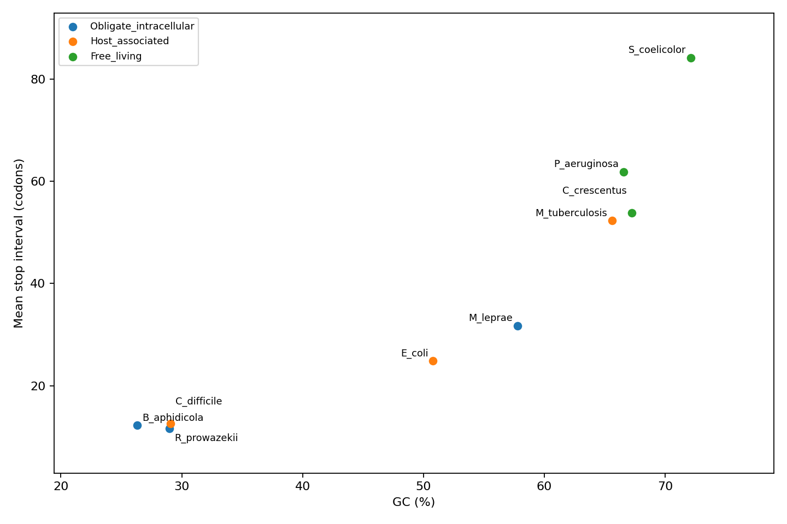

# 세균의 GC 함량과 종결 코돈 사이의 거리

충남대학교 생명정보융합학과 강유지

GC 함량이 높은 세균에서는 같은 읽기 틀의 다음 종결 코돈까지 거리가 더 길까? 처음에는 *Clostridioides difficile*과 *Streptomyces coelicolor*를 비교했고, 최종 분석에서는 세균 9종의 대표 염색체를 하나씩 사용했다.

### 내 DNA 서열로 실행하기

아래 명령은 환경 설정을 마친 뒤 저장소 최상위 폴더에서 실행한다. `my_sequence.fasta`를 분석할 DNA FASTA의 경로로 바꾸면 된다. 균주 목록에 등록할 필요가 없다.

```bash
python analyze.py --fasta-only my_sequence.fasta --out my_result
head -n 7 my_result/fasta_frames.csv
```

각 FASTA 레코드를 독립적으로 읽어 양쪽 가닥의 세 읽기 틀을 계산한다. 레코드 하나당 결과는 여섯 행이다. GC 함량, 종결 코돈 개수(`stops`), 완전한 종결 간격 수(`gaps`), 평균 간격(`mean_gap`)을 확인할 수 있다. 기본 번역표는 세균용 11번이다. CDS 안팎 비교에는 GenBank 주석이 필요하다.

**손으로 확인할 수 있는 입력** — 아래 내용을 `my_sequence.fasta`로 저장하면 된다.

```text
>demo
TAAAAGGGCTAG
```

+1 틀은 `TAA | AAG | GGC | TAG`이므로 기대값은 `stops=2`, `gaps=1`, `mean_gap=2`이다. 가운데에 `CCC`를 하나 추가한 `TAAAAGGGCCCCTAG`을 넣으면 평균 간격은 3이 된다. 계산할 수 있는 종결 간격이 없는 틀에서는 평균 칸이 비어 있다.

### 세균 9종에 적용한 결과



## 무엇을 셌나

DNA 양쪽 가닥을 세 위치에서 읽었다. 같은 틀에서 종결 코돈 두 개를 만날 때마다 그 사이의 코돈 수를 기록했다. 예를 들어 `TAA AAA GGC TAG`의 간격은 2코돈이다. 여섯 틀의 간격을 모두 합쳐 평균을 냈다. 첫 종결 앞과 마지막 종결 뒤의 구간, 모호한 코돈을 가로지르는 구간, 염색체 양 끝을 잇는 구간은 제외했다. GC 함량의 분모는 A, C, G, T의 총수다.

| 질문 | 계산 방법 | 결과 |
|---|---|---|
| GC 함량과 간격이 함께 변하나? | 각 염색체의 여섯 읽기 틀을 조사하고 9종의 순위를 비교 | [균주별 요약](results/strain_summary.csv), [상관계수](results/correlations.csv) |
| 같은 조성에서도 서열 순서가 영향을 주나? | 각 염기의 수와 모호한 염기의 위치를 유지한 채 세 번 섞어 평균 비교 | [셔플 대조군](results/shuffle.csv) |
| CDS 안팎에서 차이가 있나? | pseudo 표시를 제외한 CDS 좌표를 합친 뒤, CDS와 나머지 구간을 각각 여섯 틀로 조사 | [영역별 빈도와 간격](results/regions.csv) |
| 주석된 단백질 길이는 어떤가? | 시작·종결과 내부 종결 유무 등을 검사한 CDS에서 아미노산 수 계산 | [CDS별 결과](results/genes.csv) |
| CDS를 한두 염기 옮겨 읽으면 어떻게 되나? | 검사를 통과한 CDS에서 말단 종결을 떼고 0, 1, 2염기 이동 후 재계산 | [읽기 틀 이동](results/shifts.csv) |

비CDS는 여기서 정한 CDS 좌표 밖의 구간이다. RNA와 조절 서열도 포함될 수 있다. 여섯 틀을 훑어 얻은 간격은 DNA 서열의 특성이며, 실제로 번역된 단백질 길이는 별도의 CDS 지표로 비교했다.

## 초기 결과와 달라진 점

| 균주 | 초기 입력 길이 (bp) | 초기 GC / 거리 | 최종 염색체 길이 (bp) | 최종 GC / 간격 |
|---|---:|---:|---:|---:|
| *C. difficile* | 4,298,133 | 29.06% / 13.57 | 4,290,252 | 29.06% / 12.57 |
| *S. coelicolor* | 9,054,847 | 72.00% / 84.25 | 8,667,507 | 72.12% / 84.18 |

[초기 코드](initial/step1_gc_6frame.py)는 시작 위치부터 첫 종결까지도 세고 끝의 종결 코돈을 거리에 포함한다. [초기 결과표](initial/initial_summary.csv)와 최종 분석은 입력 길이도 다르다. 초기 분석에 쓰인 두 FASTA는 이 저장소에 들어 있지 않다. 최종 분석에서는 처음 계획한 RSCU 대신 셔플 대조군으로 염기 조성을 통제했다. 이 비교만으로 자연선택의 효과를 분리할 수는 없다.

## 실행 방법

Bash와 Python 환경에서 저장소를 복제한다. 원본 압축 파일 3개는 [data](data/)에 있다. 내부의 FASTA와 GenBank는 각각 9개이며 [체크섬](data/input_sha256.txt)으로 확인할 수 있다. 분석에 사용한 accession.version은 [strains.csv](strains.csv)에 기록했다.

```bash
git clone https://github.com/elin9785-afk/yujikang.git
cd yujikang
python3 -m venv .venv
source .venv/bin/activate
python -m pip install -r requirements-verified.txt
```

**예제 FASTA 시연** — 저장소에 풀어 둔 *Buchnera aphidicola* FASTA로 바로 실행한다. 출력은 여섯 줄이며 `frame`은 읽기 틀, `stops`는 종결 개수, `mean_gap`은 평균 간격이다. 다른 FASTA 경로로 바꿔도 같은 계산을 한다.

```bash
python analyze.py --fasta-only data/NC_002528.1.fasta --out live
head -n 7 live/fasta_frames.csv
```

**9종 전체 분석** — 원본을 복원하고 새 폴더에 결과를 쓴다.

```bash
python download_data.py
sha256sum -c data/input_sha256.txt
bash run_all.sh strains.csv data reproduced_results 3
```

[run_all.sh](run_all.sh)는 [테스트](test_all.py), [유전체 분석](analyze.py), [종 간 비교](compare.py), [그림 생성](plot.py), [출력 검사](check_output.py) 순으로 실행한다. `--fasta-only`는 서열만 읽고, CDS 분석에는 GenBank 주석을 사용한다. 다른 GenBank 입력은 `strains.csv`와 같은 열을 가진 별도 목록에 파일명과 번역표를 지정한다.

**재현성 검사** — 아래 명령은 임시 폴더에서 재실행한 결과와 저장된 표를 대조한다.

```bash
python verify_reproducibility.py
python verify_reproducibility.py --full
```

전체 검사에서 원본 18개의 체크섬, 결과 CSV 8개의 모든 행, 입력 해시와 난수 설정(seed 42, 셔플 3회)이 일치했다. Python 3.12 환경에서도 기존 Python 3.13.5 결과와 CSV 값이 같았다. [기존 실행 기록](verification/reproduce_check.txt)

## 9종 비교 결과

| Species | GC (%) | 평균 종결 간격 (codons) | 셔플 평균 간격 | 코딩 밀도 (%) |
|---|---:|---:|---:|---:|
| S_coelicolor | 72.12 | 84.18 | 58.70 | 87.20 |
| P_aeruginosa | 66.56 | 61.82 | 41.98 | 89.19 |
| C_crescentus | 67.21 | 53.82 | 43.53 | 89.98 |
| E_coli | 50.79 | 24.83 | 20.90 | 85.75 |
| C_difficile | 29.06 | 12.57 | 11.32 | 82.48 |
| M_tuberculosis | 65.61 | 52.28 | 39.89 | 89.47 |
| M_leprae | 57.80 | 31.70 | 27.51 | 53.17 |
| R_prowazekii | 29.00 | 11.60 | 11.31 | 73.19 |
| B_aphidicola | 26.31 | 12.22 | 10.64 | 86.38 |

GC 함량과 평균 종결 간격의 Spearman 순위상관은 0.9667이었다. 9종 모두 원래 서열의 간격이 셔플 평균보다 길었다. 평균 간격과 검증된 CDS의 평균 아미노산 길이 사이의 순위상관은 0.3667이었다. 표본은 9종이고 종 사이의 계통 관계는 보정하지 않았다.

[그림 8개](results/figures/) · [결과표 설명](results/README.md) · [입력과 실행 설정](results/run_info.json)

영역 비교 그림의 세로축은 유효 코돈 1,000개당 종결 빈도다. 평균 간격은 `regions.csv`의 `mean_gap` 열에 있다. 정상 읽기 틀의 내부 종결이 0인 것은 CDS 선별 조건에 따른 결과다.

## LLM 활용 기록

ChatGPT로 역상보 가닥의 읽기 틀을 구현하는 방법과 셔플에서 보존할 조건을 공부했다. 여러 균주의 입력을 처리하는 코드 작성·수정, 문서 정리, 별도 환경의 재실행 검증에도 도움을 받았다.

## 파일별 전체 코드

아래 Step 01–13은 최종 9종 분석의 전체 소스 및 설정 파일이다. 각 코드 블록을 해당 파일명으로 저장할 수 있으며, 위의 실행 방법에 따라 순서대로 분석과 검증을 수행한다. 원본 데이터는 `data/`에 포함된 압축 파일에서 복원한다.

### Step 01. 필요 라이브러리 — requirements.txt

[requirements.txt](requirements.txt)

```text
biopython>=1.81,<2
matplotlib>=3.7,<4
```

### Step 02. 검증 환경 버전 — requirements-verified.txt

[requirements-verified.txt](requirements-verified.txt)

```text
biopython==1.86
matplotlib==3.10.8
```

### Step 03. 분석 대상 메타데이터 — strains.csv

[strains.csv](strains.csv)

```csv
strain,file,accession,lifestyle,table
S_coelicolor,NC_003888.3.gb,NC_003888.3,Free_living,11
P_aeruginosa,NC_002516.2.gb,NC_002516.2,Free_living,11
C_crescentus,NC_002696.2.gb,NC_002696.2,Free_living,11
E_coli,NC_000913.3.gb,NC_000913.3,Host_associated,11
C_difficile,NC_009089.1.gb,NC_009089.1,Host_associated,11
M_tuberculosis,NC_000962.3.gb,NC_000962.3,Host_associated,11
M_leprae,NC_002677.1.gb,NC_002677.1,Obligate_intracellular,11
R_prowazekii,NC_000963.1.gb,NC_000963.1,Obligate_intracellular,11
B_aphidicola,NC_002528.1.gb,NC_002528.1,Obligate_intracellular,11
```

### Step 04. 기초 계산 함수 — dna_tools.py

[dna_tools.py](dna_tools.py)

```python
import csv
import random
from math import sqrt
from Bio.Seq import Seq
from Bio.Data import CodonTable


def read_csv(path):
    with open(path, newline='', encoding='utf-8') as f:
        return list(csv.DictReader(f))


def write_csv(path, rows, columns):
    with open(path, 'w', newline='', encoding='utf-8') as f:
        w = csv.DictWriter(f, fieldnames=columns)
        w.writeheader()
        w.writerows(rows)


def ratio(a, b, scale=1):
    return scale * a / b if b else ''


def gc(s):
    n = sum(s.count(b) for b in 'ACGT')
    return ratio(s.count('G') + s.count('C'), n, 100)


def frame_stats(s, offset, table=11):
    code = CodonTable.unambiguous_dna_by_id[table]
    stop_codons = set(code.stop_codons)
    valid_codons = set(code.forward_table) | stop_codons
    valid = stops = gaps = gap_sum = 0
    previous = None
    for pos in range(offset, len(s)-2, 3):
        codon = s[pos:pos+3]
        if codon not in valid_codons:
            previous = None
            continue
        valid += 1
        if codon in stop_codons:
            stops += 1
            if previous is not None:
                gap_sum += (pos-previous)//3 - 1
                gaps += 1
            previous = pos
    return dict(valid=valid, stops=stops, gaps=gaps, gap_sum=gap_sum)


def six_frames(s, table=11):
    rows = []
    for sign, seq in [('+', s), ('-', str(Seq(s).reverse_complement()))]:
        for offset in range(3):
            row = frame_stats(seq, offset, table)
            row['frame'] = sign + str(offset+1)
            rows.append(row)
    return rows


def total_stats(rows):
    total = dict(valid=0, stops=0, gaps=0, gap_sum=0)
    for row in rows:
        for k in total:
            total[k] += row[k]
    return total


def metrics(row):
    result = dict(row)
    result['stop_rate'] = ratio(row['stops'], row['valid'], 1000)
    result['mean_gap'] = ratio(row['gap_sum'], row['gaps'])
    return result


def shuffle(s, rng):
    # Preserve A/C/G/T counts and positions of ambiguous bases.
    bases = [b for b in s if b in 'ACGT']
    rng.shuffle(bases)
    it = iter(bases)
    return ''.join(next(it) if b in 'ACGT' else b for b in s)


def merge_intervals(intervals):
    merged = []
    for a, b in sorted(intervals):
        if a >= b:
            continue
        if merged and a <= merged[-1][1]:
            merged[-1][1] = max(merged[-1][1], b)
        else:
            merged.append([a, b])
    return merged


def complement(intervals, length):
    result = []
    start = 0
    for a, b in intervals:
        if a > start:
            result.append([start, a])
        start = b
    if start < length:
        result.append([start, length])
    return result


def validate_cds(s, table=11):
    if not s or any(b not in 'ACGT' for b in s):
        return 'empty_or_ambiguous', ''
    if len(s) % 3:
        return 'bad_length', ''
    protein = str(Seq(s).translate(table=table, to_stop=False))
    if '*' in protein[:-1]:
        return 'internal_stop', ''
    if not protein.endswith('*'):
        return 'missing_stop', ''
    code = CodonTable.unambiguous_dna_by_id[table]
    if len(s) < 6 or s[:3] not in code.start_codons:
        return 'invalid_start', ''
    return 'ok', len(Seq(s).translate(table=table, to_stop=True))


def ranks(values):
    order = sorted(range(len(values)), key=lambda i: values[i])
    result = [0.0] * len(values)
    i = 0
    while i < len(order):
        j = i + 1
        while j < len(order) and values[order[j]] == values[order[i]]:
            j += 1
        for k in range(i, j):
            result[order[k]] = (i+1+j)/2
        i = j
    return result


def spearman(x, y):
    if len(x) != len(y) or len(x) < 2:
        return ''
    a, b = ranks(x), ranks(y)
    center = (len(a)+1)/2
    top = sum((u-center)*(v-center) for u,v in zip(a,b))
    bottom = sqrt(sum((u-center)**2 for u in a)*sum((v-center)**2 for v in b))
    return top/bottom if bottom else ''
```

### Step 05. 전체 유전체 및 CDS 분석 — analyze.py

[analyze.py](analyze.py)

```python
import argparse
import hashlib
import json
import platform
import random
from pathlib import Path
from statistics import mean
from Bio import SeqIO, __version__ as bio_version
from Bio.SeqFeature import ExactPosition
from dna_tools import (read_csv, write_csv, gc, ratio, frame_stats, six_frames,
                       total_stats, metrics, shuffle, merge_intervals,
                       complement, validate_cds)

STAT = ['valid','stops','gaps','gap_sum','stop_rate','mean_gap']
SUMMARY = ['strain','accession','lifestyle','genome_bp','gc_percent','mean_gap',
           'stop_rate','shuffle_mean_gap','shuffle_mean_rate','gap_difference',
           'coding_bp','coding_density','cds_count','valid_cds','mean_aa_length']


def read_genome(path, accession):
    records = []
    for r in SeqIO.parse(path, 'genbank'):
        if not accession or r.id == accession:
            records.append(r)
    if len(records) != 1:
        raise ValueError('Expected one matching chromosome: '+str(path))
    r = records[0]
    if not len(r.seq) or not any(f.type == 'CDS' for f in r.features):
        raise ValueError('Missing sequence or CDS annotation: '+r.id)
    return r


def locus(f):
    return f.qualifiers.get('locus_tag', [str(f.location)])[0]


def pseudo(f):
    return f.type == 'pseudogene' or 'pseudo' in f.qualifiers or 'pseudogene' in f.qualifiers


def analyze_cds(r, name, table):
    pseudo_ids = set()
    for f in r.features:
        if pseudo(f):
            pseudo_ids.add(locus(f))
    intervals, genes = [], []
    shift_rows = [[], [], []]
    for f in r.features:
        if f.type != 'CDS':
            continue
        q = f.qualifiers
        aa = ''
        if f.location is None:
            raise ValueError('CDS lacks location: '+r.id)
        if any(p.ref or p.ref_db for p in f.location.parts):
            raise ValueError('Remote CDS unsupported: '+r.id)
        if locus(f) in pseudo_ids:
            status = 'annotated_pseudo'
        else:
            partial = False
            for p in f.location.parts:
                a, b = int(p.start), int(p.end)
                if not 0 <= a <= b <= len(r.seq):
                    raise ValueError('Invalid CDS coordinate: '+r.id)
                intervals.append((a,b))
                if not isinstance(p.start, ExactPosition) or not isinstance(p.end, ExactPosition):
                    partial = True
            t = int(q.get('transl_table', [table])[0])
            if (partial or q.get('codon_start',['1'])[0] != '1'
                    or any(k in q for k in ['exception','transl_except','ribosomal_slippage'])):
                status = 'partial_or_exception'
            else:
                s = str(f.extract(r.seq)).upper()
                status, aa = validate_cds(s,t)
                if status == 'ok':
                    for offset in range(3):
                        shift_rows[offset].append(frame_stats(s[:-3],offset,t))
        genes.append(dict(strain=name,locus=locus(f),length_bp=len(f),status=status,aa_length=aa))
    shifts = []
    for i in range(3):
        row = metrics(total_stats(shift_rows[i]))
        row.update(strain=name,offset=i)
        shifts.append(row)
    return merge_intervals(intervals), genes, shifts


def region_stats(seq, intervals, name, region, table):
    counts = []
    bases = dict(A=0,C=0,G=0,T=0)
    bp = 0
    for a,b in intervals:
        part = seq[a:b]
        bp += len(part)
        for base in bases:
            bases[base] += part.count(base)
        # No codon or gap crosses an interval boundary.
        counts.extend(six_frames(part,table))
    result = metrics(total_stats(counts))
    result.update(strain=name,region=region,bp=bp,segments=len(intervals),
                  gc_percent=ratio(bases['G']+bases['C'],sum(bases.values()),100))
    return result


def sequence_analysis(seq, name, table, reps, seed):
    observed = None
    frames, controls = [], []
    rng = random.Random(seed)
    for rep in range(reps+1):
        s = seq if rep == 0 else shuffle(seq,rng)
        raw = six_frames(s,table)
        for f in raw:
            row = metrics(f)
            row.update(strain=name,rep=rep)
            frames.append(row)
        if rep == 0:
            observed = metrics(total_stats(raw))
        else:
            row = metrics(total_stats(raw))
            row.update(strain=name,rep=rep)
            controls.append(row)
    gaps = [r['mean_gap'] for r in controls if r['mean_gap'] != '']
    rates = [r['stop_rate'] for r in controls if r['stop_rate'] != '']
    null_gap = mean(gaps) if gaps else ''
    null_rate = mean(rates) if rates else ''
    diff = observed['mean_gap']-null_gap if observed['mean_gap'] != '' and null_gap != '' else ''
    summary = dict(strain=name,genome_bp=len(seq),gc_percent=gc(seq),
                   mean_gap=observed['mean_gap'],stop_rate=observed['stop_rate'],
                   shuffle_mean_gap=null_gap,shuffle_mean_rate=null_rate,gap_difference=diff)
    return summary, frames, controls


def main(meta,data,out,reps,seed):
    out.mkdir(parents=True,exist_ok=True)
    summaries, genes, shifts, regions, frames, controls, inputs = [],[],[],[],[],[],[]
    seen = set()
    for row in read_csv(meta):
        name = row['strain']
        if name in seen:
            raise ValueError('Duplicate strain: '+name)
        seen.add(name)
        path = data/row['file']
        r = read_genome(path,row['accession'])
        seq = str(r.seq).upper()
        table = int(row['table'])
        print('Analyzing:',name,flush=True)
        s,fr,ct = sequence_analysis(seq,name,table,reps,seed)
        intervals,g,sh = analyze_cds(r,name,table)
        reg = [region_stats(seq,intervals,name,'CDS',table),
               region_stats(seq,complement(intervals,len(seq)),name,'non_CDS',table)]
        coding_bp = sum(b-a for a,b in intervals)
        lengths = [x['aa_length'] for x in g if x['status']=='ok']
        s.update(accession=r.id,lifestyle=row['lifestyle'],coding_bp=coding_bp,
                 coding_density=ratio(coding_bp,len(seq),100),cds_count=len(g),
                 valid_cds=len(lengths),mean_aa_length=mean(lengths) if lengths else '')
        summaries.append(s)
        genes.extend(g); shifts.extend(sh); regions.extend(reg)
        frames.extend(fr); controls.extend(ct)
        inputs.append(dict(strain=name,accession=r.id,file=row['file'],table=table,
                           sha256=hashlib.sha256(path.read_bytes()).hexdigest()))
    if not summaries:
        raise ValueError('Empty metadata')
    write_csv(out/'strain_summary.csv',summaries,SUMMARY)
    write_csv(out/'genes.csv',genes,['strain','locus','length_bp','status','aa_length'])
    write_csv(out/'frames.csv',frames,['strain','rep','frame']+STAT)
    write_csv(out/'shuffle.csv',controls,['strain','rep']+STAT)
    write_csv(out/'regions.csv',regions,['strain','region','bp','segments','gc_percent']+STAT)
    write_csv(out/'shifts.csv',shifts,['strain','offset']+STAT)
    info = dict(seed=seed,reps=reps,python=platform.python_version(),biopython=bio_version,inputs=inputs)
    (out/'run_info.json').write_text(json.dumps(info,indent=2)+'\n',encoding='utf-8')


def fasta_only(path,out,table):
    out.mkdir(parents=True,exist_ok=True)
    rows = []
    for r in SeqIO.parse(path,'fasta'):
        s = str(r.seq).upper()
        if not s or any(b not in 'ACGTRYSWKMBDHVN' for b in s):
            raise ValueError('Invalid DNA FASTA: '+r.id)
        for f in six_frames(s,table):
            row = metrics(f)
            row.update(record=r.id,genome_bp=len(s),gc_percent=gc(s))
            rows.append(row)
    if not rows:
        raise ValueError('Empty FASTA')
    write_csv(out/'fasta_frames.csv',rows,['record','genome_bp','gc_percent','frame']+STAT)
    print('Saved',out/'fasta_frames.csv')


if __name__ == '__main__':
    p = argparse.ArgumentParser()
    p.add_argument('--metadata',default='strains.csv')
    p.add_argument('--data',default='data')
    p.add_argument('--out',default='results')
    p.add_argument('--reps',type=int,default=3)
    p.add_argument('--seed',type=int,default=42)
    p.add_argument('--fasta-only')
    p.add_argument('--table',type=int,default=11)
    a = p.parse_args()
    if a.fasta_only:
        fasta_only(Path(a.fasta_only),Path(a.out),a.table)
    else:
        if a.reps < 1:
            p.error('--reps must be >= 1')
        main(Path(a.metadata),Path(a.data),Path(a.out),a.reps,a.seed)
```

### Step 06. 균주별 비교 — compare.py

[compare.py](compare.py)

```python
import sys
from pathlib import Path
from statistics import mean
from dna_tools import read_csv, write_csv, spearman


def main(out):
    rows = read_csv(out/'strain_summary.csv')
    pairs = [('gc_percent','mean_gap'),('gc_percent','stop_rate'),
             ('mean_gap','mean_aa_length'),('genome_bp','coding_density')]
    correlations = []
    for a,b in pairs:
        x,y = [],[]
        for r in rows:
            if r[a] != '' and r[b] != '':
                x.append(float(r[a])); y.append(float(r[b]))
        correlations.append(dict(x=a,y=b,n=len(x),rho=spearman(x,y)))
    write_csv(out/'correlations.csv',correlations,['x','y','n','rho'])
    groups = {}
    for r in rows:
        groups.setdefault(r['lifestyle'],[]).append(r)
    result = []
    for group in groups:
        for metric in ['genome_bp','gc_percent','mean_gap','coding_density','mean_aa_length']:
            values = [float(r[metric]) for r in groups[group] if r[metric] != '']
            result.append(dict(lifestyle=group,metric=metric,n=len(values),mean=mean(values) if values else ''))
    write_csv(out/'lifestyle.csv',result,['lifestyle','metric','n','mean'])


if __name__ == '__main__':
    main(Path(sys.argv[1]))
```

### Step 07. 8개 그래프 생성 — plot.py

[plot.py](plot.py)

```python
import sys
from pathlib import Path
import matplotlib
matplotlib.use('Agg')
import matplotlib.pyplot as plt
from dna_tools import read_csv

out = Path(sys.argv[1])
fig = out/'figures'
fig.mkdir(exist_ok=True)
rows = sorted(read_csv(out/'strain_summary.csv'),key=lambda r: float(r['gc_percent']) if r['gc_percent'] else -1)


def save(name):
    plt.tight_layout()
    plt.savefig(fig/(name+'.png'),dpi=160)
    plt.close()


def bars(names,series,ylabel,name):
    plt.figure(figsize=(10,5))
    width = .8/len(series)
    for j,(label,values) in enumerate(series):
        x = []; y = []
        for i,v in enumerate(values):
            if v != '':
                x.append(i+(j-(len(series)-1)/2)*width)
                y.append(float(v))
        plt.bar(x,y,width=width,label=label)
    plt.xticks(range(len(names)),names,rotation=45,ha='right')
    plt.ylabel(ylabel)
    if len(series)>1:
        plt.legend()
    save(name)


def scatter(xkey,ykey,xlabel,ylabel,name,xscale=1):
    plt.figure(figsize=(9,6))
    points = []
    groups = {}
    for r in rows:
        if r[xkey] != '' and r[ykey] != '':
            groups.setdefault(r['lifestyle'],[]).append(r)
    for group in groups:
        x = []; y = []
        for r in groups[group]:
            x.append(float(r[xkey])/xscale); y.append(float(r[ykey]))
            points.append((x[-1], y[-1], r['strain']))
        plt.scatter(x,y,label=group)
    ax = plt.gca()
    ax.margins(x=.15, y=.12)
    ax.figure.canvas.draw()
    renderer = ax.figure.canvas.get_renderer()
    occupied = []
    for x, y, label in sorted(points):
        align = 'right' if x > sum(ax.get_xlim()) / 2 else 'left'
        dx = -4 if align == 'right' else 4
        note = ax.annotate(label, (x, y), fontsize=8, ha=align,
                           xytext=(dx, 4), textcoords='offset points')
        for dy in (4, -10, 16, -22, 28, -34):
            note.set_position((dx, dy))
            box = note.get_window_extent(renderer).expanded(1.05, 1.2)
            if not any(box.overlaps(other) for other in occupied):
                break
        occupied.append(box)
    plt.xlabel(xlabel)
    plt.ylabel(ylabel)
    if groups:
        plt.legend(fontsize=8)
    save(name)


def series_from_file(filename,key,labels,metric):
    data = read_csv(out/filename)
    series = []
    for label in labels:
        values = []
        for r in rows:
            value = ''
            for d in data:
                if d['strain']==r['strain'] and d[key]==label and d.get('rep','0')=='0':
                    value = d[metric]
                    break
            values.append(value)
        series.append((label,values))
    return series


names = [r['strain'] for r in rows]
bars(names,[('GC',[r['gc_percent'] for r in rows])],'GC (%)','01_gc')
scatter('gc_percent','mean_gap','GC (%)','Mean stop interval (codons)','02_gc_gap')
bars(names,[('Observed',[r['mean_gap'] for r in rows]),('Shuffled mean',[r['shuffle_mean_gap'] for r in rows])],
     'Mean stop interval (codons)','03_shuffle')
bars(names,series_from_file('frames.csv','frame',['+1','+2','+3','-1','-2','-3'],'mean_gap'),
     'Mean stop interval (codons)','04_frames')
bars(names,series_from_file('regions.csv','region',['CDS','non_CDS'],'stop_rate'),
     'Stops per 1000 valid codons (six frames)','05_regions')
bars(names,series_from_file('shifts.csv','offset',['0','1','2'],'stop_rate'),
     'Stops per 1000 valid codons','06_shifts')
plt.figure(figsize=(10,5))
genes = read_csv(out/'genes.csv')
values, labels = [],[]
for r in rows:
    lengths = [int(g['aa_length']) for g in genes if g['strain']==r['strain'] and g['status']=='ok']
    if lengths:
        values.append(lengths); labels.append(r['strain'])
if values:
    plt.boxplot(values,showfliers=False)
    plt.xticks(range(1,len(labels)+1),labels,rotation=45,ha='right')
else:
    plt.text(.5,.5,'No validated CDS',ha='center',transform=plt.gca().transAxes)
plt.ylabel('Validated CDS length (amino acids; outliers hidden)')
save('07_cds_lengths')
scatter('genome_bp','coding_density','Chromosome size (Mb)','Non-pseudo CDS coverage (%)','08_size_density',1e6)
```

### Step 08. 29개 기능 검사 — test_all.py

[test_all.py](test_all.py)

```python
import random
from collections import Counter
from Bio.Seq import Seq
from Bio.SeqRecord import SeqRecord
from Bio.SeqFeature import SeqFeature, SimpleLocation
from dna_tools import (gc, frame_stats, six_frames, metrics, shuffle,
                       merge_intervals, complement, validate_cds, spearman)
from analyze import analyze_cds, region_stats

n = 0


def check(name, actual, expected):
    global n
    if actual != expected:
        raise AssertionError(f'{name}: {actual!r} != {expected!r}')
    n += 1
    print('PASS:',name)


check('GC excludes N',gc('ATGCN'),50)
check('GC no valid base',gc('NNN'),'')
check('two stops one codon between',frame_stats('TAACCCTAG',0),dict(valid=3,stops=2,gaps=1,gap_sum=1))
check('adjacent stops gap zero',metrics(frame_stats('TAATAG',0))['mean_gap'],0)
check('no complete interval',metrics(frame_stats('ATGTAA',0))['mean_gap'],'')
check('ambiguous codon breaks gap',frame_stats('TAANNNTAG',0)['gaps'],0)
check('offset 1',frame_stats('ATAACCC',1)['stops'],1)
check('table 4 TGA not stop',frame_stats('TGATAG',0,4)['stops'],1)
check('six frames',len(six_frames('ATGAAATAA')),6)
check('reverse strand stop',six_frames('TTACAT')[3]['stops'],1)
s = 'AACGTNNGCAA'
t = shuffle(s,random.Random(42))
check('shuffle counts',Counter(t),Counter(s))
check('ambiguous positions',t[5:7],'NN')
check('shuffle deterministic',t,shuffle(s,random.Random(42)))
check('merge overlap',merge_intervals([(0,10),(5,15),(18,20)]),[[0,15],[18,20]])
check('complement',complement([[0,15],[18,20]],25),[[15,18],[20,25]])
check('normal CDS',validate_cds('ATGAAATAA'),('ok',2))
check('alternative start',validate_cds('GTGAAATAA'),('ok',2))
check('internal stop',validate_cds('ATGTAATAA')[0],'internal_stop')
check('bad length',validate_cds('ATGA')[0],'bad_length')
check('missing terminal stop',validate_cds('ATGAAA')[0],'missing_stop')
check('ambiguous CDS',validate_cds('ATGNNNTAA')[0],'empty_or_ambiguous')
check('positive rank correlation',spearman([1,2,3],[2,4,8]),1)
check('negative rank correlation',spearman([1,2,3],[8,4,2]),-1)
check('rank ties',spearman([1,1,3],[4,4,8]),1)
check('constant rank undefined',spearman([1,1],[2,3]),'')
# Two separated intervals contain just one stop each; never join them.
check('region boundaries',region_stats('TAAAAATAG',[[0,3],[6,9]],'x','CDS',11)['gaps'],0)
r = SeqRecord(Seq('TTATTTCATATGAAATAA'),id='test')
r.features = [SeqFeature(SimpleLocation(0,9,strand=-1),type='CDS',qualifiers={'locus_tag':['a']}),
              SeqFeature(SimpleLocation(9,18),type='gene',qualifiers={'locus_tag':['b'],'pseudo':['']}),
              SeqFeature(SimpleLocation(9,18),type='CDS',qualifiers={'locus_tag':['b']})]
intervals,genes,shifts = analyze_cds(r,'test',11)
check('reverse CDS',genes[0]['status'],'ok')
check('annotated pseudo excluded',intervals,[[0,9]])
check('normal reading frame internal stops',shifts[0]['stops'],0)
print(n,'checks passed')
```

### Step 09. 합성 데이터 생성 — demo.py

[demo.py](demo.py)

```python
from pathlib import Path
from Bio import SeqIO
from Bio.Seq import Seq
from Bio.SeqRecord import SeqRecord
from Bio.SeqFeature import SeqFeature, SimpleLocation
from dna_tools import write_csv

p = Path('demo_data')
p.mkdir(exist_ok=True)
rows = []
for i, middle in enumerate(['ATGAAATAA','ATGGCCTAA','ATGGGCGCCTAA']):
    name = 'demo'+str(i)
    # Two genuine CDS, an internal-stop CDS, and non-CDS sequence.
    first = 'ATGAAATAA'
    reverse = str(Seq(middle).reverse_complement())
    broken = 'ATGTAATAA'
    tail = 'TAACCCTAG' + 'ACGT'*(i+2)
    s = first+reverse+broken+tail
    a = len(first)
    b = a+len(reverse)
    c = b+len(broken)
    r = SeqRecord(Seq(s),id=name,description='Synthetic test only')
    r.annotations['molecule_type'] = 'DNA'
    r.annotations['date'] = '01-JAN-2000'
    r.features = [
        SeqFeature(SimpleLocation(0,a,strand=1),type='CDS',qualifiers={'locus_tag':['a']}),
        SeqFeature(SimpleLocation(a,b,strand=-1),type='CDS',qualifiers={'locus_tag':['b']}),
        SeqFeature(SimpleLocation(b,c,strand=1),type='CDS',qualifiers={'locus_tag':['c']})]
    SeqIO.write(r,p/(name+'.gb'),'genbank')
    SeqIO.write(r,p/(name+'.fasta'),'fasta')
    rows.append(dict(strain=name,file=name+'.gb',accession=name,lifestyle='Synthetic',table=11))
write_csv('demo_strains.csv',rows,['strain','file','accession','lifestyle','table'])
```

### Step 10. 결과 검증 — check_output.py

[check_output.py](check_output.py)

```python
import sys
import math
from pathlib import Path
from dna_tools import read_csv

meta, out, reps = Path(sys.argv[1]),Path(sys.argv[2]),int(sys.argv[3])
rows = read_csv(out/'strain_summary.csv')
assert [r['strain'] for r in rows] == [r['strain'] for r in read_csv(meta)]
assert rows
frames = read_csv(out/'frames.csv')
regions = read_csv(out/'regions.csv')
shifts = read_csv(out/'shifts.csv')
genes = read_csv(out/'genes.csv')
controls = read_csv(out/'shuffle.csv')
for r in rows:
    name = r['strain']
    f = [x for x in frames if x['strain']==name]
    assert len(f)==6*(reps+1)
    assert len({(x['rep'],x['frame']) for x in f})==len(f)
    assert len([x for x in controls if x['strain']==name])==reps
    reg = [x for x in regions if x['strain']==name]
    assert len(reg)==2
    assert sum(int(x['bp']) for x in reg)==int(r['genome_bp'])
    assert int(reg[0]['bp'])==int(r['coding_bp'])
    assert math.isclose(float(r['coding_density']),100*int(r['coding_bp'])/int(r['genome_bp']))
    assert 0 <= float(r['coding_density']) <= 100
    g = [x for x in genes if x['strain']==name]
    assert len(g)==int(r['cds_count'])
    assert len([x for x in g if x['status']=='ok'])==int(r['valid_cds'])
    assert len([x for x in shifts if x['strain']==name])==3
    obs = [x for x in f if x['rep']=='0']
    gaps = sum(int(x['gaps']) for x in obs)
    if gaps:
        assert math.isclose(float(r['mean_gap']),sum(int(x['gap_sum']) for x in obs)/gaps)
    else:
        assert r['mean_gap']==''
for filename in ['frames.csv','regions.csv','shifts.csv','shuffle.csv']:
    for r in read_csv(out/filename):
        assert 0<=int(r['gaps'])<=int(r['stops'])<=int(r['valid'])
        assert int(r['gap_sum'])>=0
assert len(read_csv(out/'correlations.csv'))==4
figs = ['01_gc','02_gc_gap','03_shuffle','04_frames','05_regions','06_shifts','07_cds_lengths','08_size_density']
for name in figs:
    assert (out/'figures'/(name+'.png')).stat().st_size>0
print('PASS: metadata order, CSV relationships, 8 figures')
```

### Step 11. 전체 자동 실행 — run_all.sh

[run_all.sh](run_all.sh)

```bash
#!/usr/bin/env bash
set -euo pipefail
cd "$(dirname "$0")"
META="${1:-strains.csv}"
DATA="${2:-data}"
OUT="${3:-results}"
REPS="${4:-3}"
python test_all.py
python analyze.py --metadata "$META" --data "$DATA" --out "$OUT" --reps "$REPS" --seed 42
python compare.py "$OUT"
python plot.py "$OUT"
python check_output.py "$META" "$OUT" "$REPS"
echo "Pipeline completed: $OUT"
```

### Step 12. 원본 데이터 준비 — download_data.py

[download_data.py](download_data.py)

```python
"""Restore exact original inputs from ZIP archives or NCBI EFetch."""
import hashlib
from pathlib import Path
from time import sleep
from urllib.parse import urlencode
from urllib.request import Request, urlopen
from zipfile import ZipFile
import argparse


def digest(payload):
    return hashlib.sha256(payload).hexdigest()


def main():
    p = argparse.ArgumentParser(description=__doc__)
    p.add_argument('--ncbi', action='store_true', help='Try NCBI for missing files')
    args = p.parse_args()
    data = Path('data')
    manifest = data / 'input_sha256.txt'
    missing = []
    archives = sorted(data.glob('originals_*.zip'))
    for line in manifest.read_text().splitlines():
        expected, name = line.split(maxsplit=1)
        target = Path(name)
        if target.exists():
            if digest(target.read_bytes()) != expected:
                raise SystemExit(f'Checksum mismatch (not overwritten): {target}')
            print('OK:', target)
            continue
        payload = None
        for archive in archives:
            with ZipFile(archive) as z:
                if name in z.namelist():
                    payload = z.read(name)
                    if digest(payload) != expected:
                        raise SystemExit(f'Invalid original in {archive}: {name}')
                    break
        if payload is None and args.ncbi:
            accession = target.stem
            rettypes = ['gbwithparts', 'gb'] if target.suffix == '.gb' else ['fasta']
            for rettype in rettypes:
                query = urlencode({'db': 'nuccore', 'id': accession,
                                   'rettype': rettype, 'retmode': 'text',
                                   'tool': 'gc_stop_tutorial'})
                url = 'https://eutils.ncbi.nlm.nih.gov/entrez/eutils/efetch.fcgi?' + query
                try:
                    with urlopen(Request(url, headers={'User-Agent': 'GC-stop-tutorial/1.0'}), timeout=180) as response:
                        candidate = response.read()
                except OSError as exc:
                    print(f'NCBI request failed for {name}: {exc}')
                    continue
                finally:
                    sleep(0.5)
                if digest(candidate) == expected:
                    payload = candidate
                    break
        if payload is None:
            missing.append(name)
            continue
        target.parent.mkdir(parents=True, exist_ok=True)
        target.write_bytes(payload)
        print('Restored and verified:', target)
    if missing:
        print('Missing or not byte-identical to original:')
        print('\n'.join(missing))
        raise SystemExit('Obtain the original files or originals_*.zip archives. No mismatched data saved.')
    print('PASS: all original input checksums match')


if __name__ == '__main__':
    main()
```

### Step 13. 재현성 확인 — verify_reproducibility.py

[verify_reproducibility.py](verify_reproducibility.py)

```python
"""Rerun the published pipeline and check its newly generated results."""
import argparse
import csv
import hashlib
import json
from pathlib import Path
import subprocess
import sys
import tempfile

ROOT = Path(__file__).resolve().parent
SAMPLE = 'B_aphidicola'
CSV_NAMES = ('strain_summary.csv', 'frames.csv', 'genes.csv', 'regions.csv',
             'shifts.csv', 'shuffle.csv', 'correlations.csv', 'lifestyle.csv')


def require(condition, message):
    if not condition:
        raise SystemExit('FAIL: ' + message)


def check_hashes(manifest, selected=None):
    count = 0
    for line in (ROOT / manifest).read_text().splitlines():
        expected, name = line.split(maxsplit=1)
        if selected is not None and name not in selected:
            continue
        path = ROOT / name
        require(path.is_file(), 'Missing file: ' + name)
        require(hashlib.sha256(path.read_bytes()).hexdigest() == expected,
                'Checksum mismatch: ' + name)
        count += 1
    if selected is not None:
        require(count == len(selected), 'Incomplete checksum manifest')
    print(f'PASS: {count} file checksums ({manifest})', flush=True)


def run(work, *args):
    print('RUN:', ' '.join(str(x) for x in args), flush=True)
    subprocess.run([sys.executable, *map(str, args)], cwd=work, check=True)


def rows(path):
    with path.open(newline='', encoding='utf-8') as f:
        return list(csv.DictReader(f))


def pipeline(work, meta, data, out):
    run(work, ROOT / 'analyze.py', '--metadata', meta, '--data', data,
        '--out', out, '--reps', '3', '--seed', '42')
    run(work, ROOT / 'compare.py', out)
    run(work, ROOT / 'plot.py', out)
    run(work, ROOT / 'check_output.py', meta, out, '3')


def compare_csv(actual, reference, sample=None):
    for name in CSV_NAMES:
        if sample is not None and name in ('correlations.csv', 'lifestyle.csv'):
            continue
        expected = rows(reference / name)
        if sample is not None:
            expected = [row for row in expected if row['strain'] == sample]
        require(rows(actual / name) == expected, 'Different CSV: ' + name)
        print('MATCH:', name, flush=True)


def main():
    p = argparse.ArgumentParser(description=__doc__)
    p.add_argument('--full', action='store_true', help='Restore and rerun all nine original genomes')
    args = p.parse_args()
    check_hashes('verification/source_sha256.txt')
    if args.full:
        run(ROOT, ROOT / 'download_data.py')
        check_hashes('data/input_sha256.txt')
    else:
        check_hashes('data/input_sha256.txt',
                     {'data/NC_002528.1.gb', 'data/NC_002528.1.fasta'})
    with tempfile.TemporaryDirectory(prefix='gc_reproduce_') as tmp:
        work = Path(tmp)
        run(work, ROOT / 'test_all.py')
        if not args.full:
            run(work, ROOT / 'demo.py')
            pipeline(work, 'demo_strains.csv', 'demo_data', 'demo_a')
            pipeline(work, 'demo_strains.csv', 'demo_data', 'demo_b')
            a, b = work / 'demo_a', work / 'demo_b'
            files = sorted(p.relative_to(a) for p in a.rglob('*') if p.is_file())
            require(files == sorted(p.relative_to(b) for p in b.rglob('*') if p.is_file()),
                    'Synthetic output file list differs')
            for name in files:
                require((a/name).read_bytes() == (b/name).read_bytes(),
                        'Synthetic repeat differs: ' + str(name))
            print(f'PASS: synthetic repeat ({len(files)} files)', flush=True)
            meta = work / 'single.csv'
            selected = [row for row in rows(ROOT / 'strains.csv') if row['strain'] == SAMPLE]
            require(len(selected) == 1, 'Sample metadata missing or duplicated')
            with meta.open('w', newline='', encoding='utf-8') as f:
                writer = csv.DictWriter(f, fieldnames=list(selected[0]))
                writer.writeheader()
                writer.writerows(selected)
            run(work, ROOT / 'analyze.py', '--fasta-only', ROOT / 'data/NC_002528.1.fasta',
                '--out', 'live')
            frames = rows(work / 'live/fasta_frames.csv')
            expected = [r for r in rows(ROOT / 'results/frames.csv')
                        if r['strain'] == SAMPLE and r['rep'] == '0']
            require(len(frames) == len(expected) == 6, 'Expected six frames')
            for actual, ref in zip(frames, expected):
                require(all(actual[k] == ref[k] for k in ref if k not in ('strain', 'rep')),
                        'FASTA frame differs: ' + ref['frame'])
            print('PASS: real FASTA, all six frames match', flush=True)
        else:
            meta = ROOT / 'strains.csv'
        pipeline(work, meta, ROOT / 'data', 'actual')
        compare_csv(work / 'actual', ROOT / 'results', None if args.full else SAMPLE)
        if args.full:
            actual = json.loads((work / 'actual/run_info.json').read_text())
            expected = json.loads((ROOT / 'results/run_info.json').read_text())
            for key in ('seed', 'reps', 'inputs'):
                require(actual[key] == expected[key], 'Different run setting: ' + key)
            print('PASS: original input hashes, seed and repeat count match', flush=True)
            if actual == expected:
                print('MATCH: run_info.json (including versions)', flush=True)
            else:
                print('NOTE: environment version differs; CSV values matched exactly', flush=True)
        print('PASS: FULL nine-genome reproduction' if args.full else
              'PASS: QUICK public-data reproduction (one genome + synthetic repeats)', flush=True)


if __name__ == '__main__':
    main()
```

## 초기 2종 분석 코드 (참고)

[initial/step1_gc_6frame.py](initial/step1_gc_6frame.py)의 전체 원문이다. 최종 9종 분석에는 위 Step 01–13을 사용한다. 초기 분석의 입력 FASTA는 현재 저장소에 포함되어 있지 않다.

```python
import csv
from Bio import SeqIO

STOP_CODONS = {"TAA", "TAG", "TGA"}

def get_gc_and_6frame_stops(fasta_file):
    total_gc, total_len = 0, 0
    stop_dists = []

    for record in SeqIO.parse(fasta_file, "fasta"):
        seq = record.seq.upper()
        s_str = str(seq)
        total_gc += s_str.count('G') + s_str.count('C')
        total_len += len(s_str)

        for strand in [seq, seq.reverse_complement()]:
            st = str(strand)
            for frame in range(3):
                count = 0
                for i in range(frame, len(st) - 2, 3):
                    codon = st[i:i+3]
                    if set(codon) - {'A', 'T', 'G', 'C'}:
                        count = 0
                        continue
                    count += 1
                    if codon in STOP_CODONS:
                        stop_dists.append(count)
                        count = 0

    gc_pct = round((total_gc / total_len) * 100, 2)
    mean_dist = round(sum(stop_dists) / len(stop_dists), 2)
    return total_len, gc_pct, mean_dist

c_len, c_gc, c_dist = get_gc_and_6frame_stops("C_diff_genome.fna")
s_len, s_gc, s_dist = get_gc_and_6frame_stops("S_coel_genome.fna")

rows = [
    ["Species", "Genome_bp", "GC_%", "Mean_6Frame_Stop_Dist"],
    ["Clostridioides difficile", c_len, c_gc, c_dist],
    ["Streptomyces coelicolor", s_len, s_gc, s_dist]
]

for r in rows:
    print(f"{r[0]:<26} {str(r[1]):<12} {str(r[2]):<8} {r[3]}")

with open("initial_summary.csv", "w", newline="") as f:
    csv.writer(f).writerows(rows)
```
