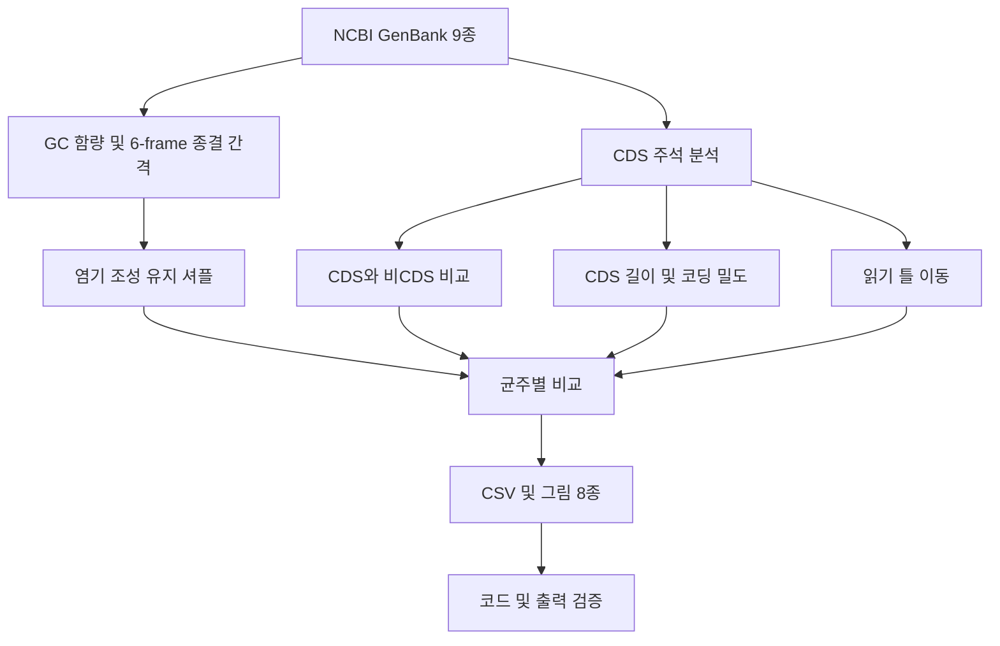

# 세균의 GC 함량과 코딩 영역 특성에 따른 종결 코돈 분포 비교 분석

**Comparative Analysis of Stop Codon Distribution in Relation to GC Content and Coding Region Characteristics in Bacterial Genomes**

충남대학교 생명정보융합학과 · 생명정보학 컴퓨팅 기말 프로젝트

`Python` · `Biopython` · `Matplotlib` · `NCBI RefSeq`

## 목차

- [1. 연구 배경과 목적](#1-연구-배경과-목적)
- [2. LLM을 활용한 학습 내용](#2-llm을-활용한-학습-내용)
- [3. 분석 대상과 원본 데이터](#3-분석-대상과-원본-데이터)
- [4. 실행 환경과 데이터 준비](#4-실행-환경과-데이터-준비)
- [5. 초기 2종 분석 코드](#5-초기-2종-분석-코드)
- [6. 최종 9종 분석 전체 코드](#6-최종-9종-분석-전체-코드)
- [7. 실행과 재현성 확인](#7-실행과-재현성-확인)
- [8. 실제 분석 결과](#8-실제-분석-결과)
- [9. 분석의 한계 및 참고자료](#9-분석의-한계-및-참고자료)

## 1. 연구 배경과 목적

GC 함량이 다른 두 세균의 종결 코돈 분포를 비교하는 초기 연구에서 출발하여, 9종의 유전체로 분석 대상을 확장했다. GC 함량만으로 종결 코돈 간격의 차이를 설명할 수 있는지, 염기 배열과 코딩 영역의 특성이 어떤 관련성을 보이는지 비교하는 것이 목적이다.



## 2. LLM을 활용한 학습 내용

처음에는 GC 함량과 종결 코돈 분포를 비교하는 분석부터 시작했다. 이후 LLM을 활용하여 분석 대상을 9종으로 확장하는 방법과, 입력부터 출력까지 연결하는 파이프라인 구조를 질문했다. 단순한 수치 비교를 넘어서 염기 조성을 보존한 대조군과 실제 CDS 주석을 이용하는 방향을 구체화했다.

### Python과 Biopython

- FASTA는 주로 서열을 제공하고 GenBank는 서열과 주석을 함께 제공한다. `SeqIO.parse()`를 사용하면 여러 레코드를 읽을 수 있다.
- 정방향과 역상보 방향에 각각 세 읽기 틀이 존재한다. `for`, `range()`, 조건문을 이용하여 코돈을 3염기씩 탐색하는 구조를 코드로 표현했다.
- 계산을 함수로 나누고, 여러 종의 데이터를 CSV에 저장하도록 구성하는 방법을 학습 주제로 삼았다.

### 생물학적 분석을 코드로 구현하기

- GC 함량을 계산할 때 유효한 A/C/G/T만 분모에 포함하는 방식과 초기 코드의 정의를 구분한다.
- 종결 코돈 간격과 실제 CDS 길이는 같은 값이 아니다. GenBank의 CDS 좌표와 방향을 반영해 실제 서열을 추출해야 한다.
- 염기 조성을 유지한 셔플은 단일 염기의 개수를 통제하지만 코돈 사용과 이염기 조성을 통제하지 못한다.
- CDS와 비CDS의 비교에서는 겹치는 CDS 좌표의 중복을 제거하고, 비CDS를 기능이 없는 DNA로 단정하지 않는다.

### 검증과 재현성

LLM에 다른 서열에서도 작동하는 방법, 예외 처리, 단위 검사와 전체 자동 실행을 요청했다. 코드가 생성되었다는 사실만으로 실행 성공을 판단할 수 없으므로 입력 파일, 난수 seed, 패키지 버전 및 출력 결과를 함께 기록하는 방식으로 구성했다. 실제 9종 검증은 제공한 원본을 이용한 ChatGPT 실행 환경의 결과이며 학교 서버 실행과 별도로 구분한다.

## 3. 분석 대상과 원본 데이터

[9종 메타데이터](strains.csv) · [입력 데이터 체크섬](data/input_sha256.txt)

| Species | NCBI RefSeq accession | 분석 그룹 |
|---|---|---|
| S_coelicolor | [NC_003888.3](https://www.ncbi.nlm.nih.gov/nuccore/NC_003888.3) | Free_living |
| P_aeruginosa | [NC_002516.2](https://www.ncbi.nlm.nih.gov/nuccore/NC_002516.2) | Free_living |
| C_crescentus | [NC_002696.2](https://www.ncbi.nlm.nih.gov/nuccore/NC_002696.2) | Free_living |
| E_coli | [NC_000913.3](https://www.ncbi.nlm.nih.gov/nuccore/NC_000913.3) | Host_associated |
| C_difficile | [NC_009089.1](https://www.ncbi.nlm.nih.gov/nuccore/NC_009089.1) | Host_associated |
| M_tuberculosis | [NC_000962.3](https://www.ncbi.nlm.nih.gov/nuccore/NC_000962.3) | Host_associated |
| M_leprae | [NC_002677.1](https://www.ncbi.nlm.nih.gov/nuccore/NC_002677.1) | Obligate_intracellular |
| R_prowazekii | [NC_000963.1](https://www.ncbi.nlm.nih.gov/nuccore/NC_000963.1) | Obligate_intracellular |
| B_aphidicola | [NC_002528.1](https://www.ncbi.nlm.nih.gov/nuccore/NC_002528.1) | Obligate_intracellular |

각 종에서 대표 염색체 하나를 사용한다. 그룹은 비교를 위한 분류 기준이며 인과관계 또는 계통적으로 독립적인 반복을 의미하지 않는다. GenBank 9개와 FASTA 9개는 실제 제공 원본이며 서로 서열 및 accession이 일치하는 것을 확인하였다.

**현재 B. aphidicola의 원본 GenBank와 FASTA 2개를 공개했다.** 나머지 8종의 GenBank·FASTA 원본은 추가 전송이 필요하다. 아래 원본 체크섬과 NCBI 링크를 이용하여 확보하고 검증할 수 있다. NCBI에서 내려받은 주석이나 파일 형식이 달라져 체크섬이 불일치할 수 있으므로 해당 경우에는 실제 사용 원본을 확보해야 한다.

## 4. 실행 환경과 데이터 준비

Bash 환경(Linux, WSL 등), Python 3.13.5, Biopython 1.86, Matplotlib 3.10.8로 검증했다.

```bash
git clone https://github.com/elin9785-afk/yujikang.git
cd yujikang
python3 -m venv .venv
source .venv/bin/activate
python -m pip install -r requirements-verified.txt
```

GenBank 원본은 `data/NC_*.gb`, FASTA는 `data/NC_*.fasta`에 둔다. 실제 원본을 확보했다면 다운로드를 건너뛰고 체크섬만 검사한다. 아래는 NCBI에서 원본을 복구하기 위해 추가한 보조 코드로, 원래 분석 코드와 구분한다. SHA-256이 정확하게 일치하는 응답만 저장하며, 기존 파일을 덮어쓰지 않는다. 네트워크 다운로드 자체는 아직 확인되지 않았다.

```python
import hashlib
from pathlib import Path
from time import sleep
from urllib.parse import urlencode
from urllib.request import urlopen, Request

# Download only missing files. Never overwrite existing original files.
# EFetch may return changed annotations; reject any byte mismatch.
for line in Path("data/input_sha256.txt").read_text().splitlines():
    expected, name = line.split(maxsplit=1)
    target = Path(name)
    if target.exists():
        if hashlib.sha256(target.read_bytes()).hexdigest() != expected:
            raise SystemExit(f"Checksum mismatch: {target}")
        print("Verified:", target)
        continue
    accession = target.stem
    rettypes = ["gbwithparts", "gb"] if target.suffix == ".gb" else ["fasta"]
    for rettype in rettypes:
        query = urlencode({"db": "nuccore", "id": accession,
                           "rettype": rettype, "retmode": "text",
                           "tool": "gc_stop_tutorial"})
        url = "https://eutils.ncbi.nlm.nih.gov/entrez/eutils/efetch.fcgi?" + query
        with urlopen(Request(url, headers={"User-Agent": "GC-stop-tutorial/1.0"}), timeout=180) as response:
            payload = response.read()
        sleep(0.5)
        if hashlib.sha256(payload).hexdigest() == expected:
            target.parent.mkdir(parents=True, exist_ok=True)
            target.write_bytes(payload)
            print("Verified and saved:", target)
            break
    else:
        raise SystemExit(f"NCBI response differs from original: {target}. Obtain the original uploaded input.")
```

저장소 최상위에서 `python download_data.py`로 실행할 수 있다.

```bash
sha256sum -c data/input_sha256.txt
```

## 5. 초기 2종 분석 코드

초기 연구에서는 저GC와 고GC 유전체의 GC 함량 및 여섯 읽기 틀의 종결 거리 지표를 비교했다. 아래는 기존 [step1_gc_6frame.py](step1_gc_6frame.py) 원문이다. 최종 9종 분석은 이 초기 코드 대신 다음 절의 파이프라인을 사용한다.

```python
import csv
from Bio import SeqIO

STOP_CODONS = {"TAA", "TAG", "TGA"}

def get_gc_and_6frame_stops(fasta_file):
    total_gc, total_len = 0, 0
    stop_dists = []

    for record in SeqIO.parse(fasta_file, "fasta"):
        seq = record.seq.upper()
        s_str = str(seq)
        total_gc += s_str.count('G') + s_str.count('C')
        total_len += len(s_str)

        for strand in [seq, seq.reverse_complement()]:
            st = str(strand)
            for frame in range(3):
                count = 0
                for i in range(frame, len(st) - 2, 3):
                    codon = st[i:i+3]
                    if set(codon) - {'A', 'T', 'G', 'C'}:
                        count = 0
                        continue
                    count += 1
                    if codon in STOP_CODONS:
                        stop_dists.append(count)
                        count = 0

    gc_pct = round((total_gc / total_len) * 100, 2)
    mean_dist = round(sum(stop_dists) / len(stop_dists), 2)
    return total_len, gc_pct, mean_dist

c_len, c_gc, c_dist = get_gc_and_6frame_stops("C_diff_genome.fna")
s_len, s_gc, s_dist = get_gc_and_6frame_stops("S_coel_genome.fna")

rows = [
    ["Species", "Genome_bp", "GC_%", "Mean_6Frame_Stop_Dist"],
    ["Clostridioides difficile", c_len, c_gc, c_dist],
    ["Streptomyces coelicolor", s_len, s_gc, s_dist]
]

for r in rows:
    print(f"{r[0]:<26} {str(r[1]):<12} {str(r[2]):<8} {r[3]}")

with open("initial_summary.csv", "w", newline="") as f:
    csv.writer(f).writerows(rows)
```

초기 결과(기존 저장 기록):

```csv
Species,Genome_bp,GC_%,Mean_6Frame_Stop_Dist
Clostridioides difficile,4298133,29.06,13.57
Streptomyces coelicolor,9054847,72.0,84.25
```

초기 입력 자료와 결과는 [이전 커밋](https://github.com/elin9785-afk/yujikang/tree/04a157d70df2523d608346208b3d288f8c3eb9be)에서 확인할 수 있다. 초기 코드는 종결 코돈을 포함한 거리 및 시작 구간을 포함하고 전체 염기 길이를 GC 분모로 사용하므로 최종 코드의 지표와 직접 동일시하지 않는다.

## 6. 최종 9종 분석 전체 코드

다음 코드 블록은 실제 제공 데이터로 실행한 검증 버전의 각 파일 원문 전체이다. 파일을 직접 작성하는 경우 각 블록을 같은 이름으로 저장한다. 소스 파일 링크로 바로 열 수도 있다. 학교 서버의 최종 소스와 완전히 동일한지는 아직 대조하지 못했다.

### Step 01. 필요 라이브러리 — requirements.txt

[requirements.txt](requirements.txt)

```text
biopython>=1.81,<2
matplotlib>=3.7,<4
```

### Step 02. 검증 환경 버전 — requirements-verified.txt

[requirements-verified.txt](requirements-verified.txt)

```text
biopython==1.86
matplotlib==3.10.8
```

### Step 03. 분석 대상 메타데이터 — strains.csv

[strains.csv](strains.csv)

```csv
strain,file,accession,lifestyle,table
S_coelicolor,NC_003888.3.gb,NC_003888.3,Free_living,11
P_aeruginosa,NC_002516.2.gb,NC_002516.2,Free_living,11
C_crescentus,NC_002696.2.gb,NC_002696.2,Free_living,11
E_coli,NC_000913.3.gb,NC_000913.3,Host_associated,11
C_difficile,NC_009089.1.gb,NC_009089.1,Host_associated,11
M_tuberculosis,NC_000962.3.gb,NC_000962.3,Host_associated,11
M_leprae,NC_002677.1.gb,NC_002677.1,Obligate_intracellular,11
R_prowazekii,NC_000963.1.gb,NC_000963.1,Obligate_intracellular,11
B_aphidicola,NC_002528.1.gb,NC_002528.1,Obligate_intracellular,11
```

### Step 04. 기초 계산 함수 — dna_tools.py

[dna_tools.py](dna_tools.py)

```python
import csv
import random
from math import sqrt
from Bio.Seq import Seq
from Bio.Data import CodonTable


def read_csv(path):
    with open(path, newline='', encoding='utf-8') as f:
        return list(csv.DictReader(f))


def write_csv(path, rows, columns):
    with open(path, 'w', newline='', encoding='utf-8') as f:
        w = csv.DictWriter(f, fieldnames=columns)
        w.writeheader()
        w.writerows(rows)


def ratio(a, b, scale=1):
    return scale * a / b if b else ''


def gc(s):
    n = sum(s.count(b) for b in 'ACGT')
    return ratio(s.count('G') + s.count('C'), n, 100)


def frame_stats(s, offset, table=11):
    code = CodonTable.unambiguous_dna_by_id[table]
    stop_codons = set(code.stop_codons)
    valid_codons = set(code.forward_table) | stop_codons
    valid = stops = gaps = gap_sum = 0
    previous = None
    for pos in range(offset, len(s)-2, 3):
        codon = s[pos:pos+3]
        if codon not in valid_codons:
            previous = None
            continue
        valid += 1
        if codon in stop_codons:
            stops += 1
            if previous is not None:
                gap_sum += (pos-previous)//3 - 1
                gaps += 1
            previous = pos
    return dict(valid=valid, stops=stops, gaps=gaps, gap_sum=gap_sum)


def six_frames(s, table=11):
    rows = []
    for sign, seq in [('+', s), ('-', str(Seq(s).reverse_complement()))]:
        for offset in range(3):
            row = frame_stats(seq, offset, table)
            row['frame'] = sign + str(offset+1)
            rows.append(row)
    return rows


def total_stats(rows):
    total = dict(valid=0, stops=0, gaps=0, gap_sum=0)
    for row in rows:
        for k in total:
            total[k] += row[k]
    return total


def metrics(row):
    result = dict(row)
    result['stop_rate'] = ratio(row['stops'], row['valid'], 1000)
    result['mean_gap'] = ratio(row['gap_sum'], row['gaps'])
    return result


def shuffle(s, rng):
    # Preserve A/C/G/T counts and positions of ambiguous bases.
    bases = [b for b in s if b in 'ACGT']
    rng.shuffle(bases)
    it = iter(bases)
    return ''.join(next(it) if b in 'ACGT' else b for b in s)


def merge_intervals(intervals):
    merged = []
    for a, b in sorted(intervals):
        if a >= b:
            continue
        if merged and a <= merged[-1][1]:
            merged[-1][1] = max(merged[-1][1], b)
        else:
            merged.append([a, b])
    return merged


def complement(intervals, length):
    result = []
    start = 0
    for a, b in intervals:
        if a > start:
            result.append([start, a])
        start = b
    if start < length:
        result.append([start, length])
    return result


def validate_cds(s, table=11):
    if not s or any(b not in 'ACGT' for b in s):
        return 'empty_or_ambiguous', ''
    if len(s) % 3:
        return 'bad_length', ''
    protein = str(Seq(s).translate(table=table, to_stop=False))
    if '*' in protein[:-1]:
        return 'internal_stop', ''
    if not protein.endswith('*'):
        return 'missing_stop', ''
    code = CodonTable.unambiguous_dna_by_id[table]
    if len(s) < 6 or s[:3] not in code.start_codons:
        return 'invalid_start', ''
    return 'ok', len(Seq(s).translate(table=table, to_stop=True))


def ranks(values):
    order = sorted(range(len(values)), key=lambda i: values[i])
    result = [0.0] * len(values)
    i = 0
    while i < len(order):
        j = i + 1
        while j < len(order) and values[order[j]] == values[order[i]]:
            j += 1
        for k in range(i, j):
            result[order[k]] = (i+1+j)/2
        i = j
    return result


def spearman(x, y):
    if len(x) != len(y) or len(x) < 2:
        return ''
    a, b = ranks(x), ranks(y)
    center = (len(a)+1)/2
    top = sum((u-center)*(v-center) for u,v in zip(a,b))
    bottom = sqrt(sum((u-center)**2 for u in a)*sum((v-center)**2 for v in b))
    return top/bottom if bottom else ''
```

### Step 05. 전체 유전체 및 CDS 분석 — analyze.py

[analyze.py](analyze.py)

```python
import argparse
import hashlib
import json
import platform
import random
from pathlib import Path
from statistics import mean
from Bio import SeqIO, __version__ as bio_version
from Bio.SeqFeature import ExactPosition
from dna_tools import (read_csv, write_csv, gc, ratio, frame_stats, six_frames,
                       total_stats, metrics, shuffle, merge_intervals,
                       complement, validate_cds)

STAT = ['valid','stops','gaps','gap_sum','stop_rate','mean_gap']
SUMMARY = ['strain','accession','lifestyle','genome_bp','gc_percent','mean_gap',
           'stop_rate','shuffle_mean_gap','shuffle_mean_rate','gap_difference',
           'coding_bp','coding_density','cds_count','valid_cds','mean_aa_length']


def read_genome(path, accession):
    records = []
    for r in SeqIO.parse(path, 'genbank'):
        if not accession or r.id == accession:
            records.append(r)
    if len(records) != 1:
        raise ValueError('Expected one matching chromosome: '+str(path))
    r = records[0]
    if not len(r.seq) or not any(f.type == 'CDS' for f in r.features):
        raise ValueError('Missing sequence or CDS annotation: '+r.id)
    return r


def locus(f):
    return f.qualifiers.get('locus_tag', [str(f.location)])[0]


def pseudo(f):
    return f.type == 'pseudogene' or 'pseudo' in f.qualifiers or 'pseudogene' in f.qualifiers


def analyze_cds(r, name, table):
    pseudo_ids = set()
    for f in r.features:
        if pseudo(f):
            pseudo_ids.add(locus(f))
    intervals, genes = [], []
    shift_rows = [[], [], []]
    for f in r.features:
        if f.type != 'CDS':
            continue
        q = f.qualifiers
        aa = ''
        if f.location is None:
            raise ValueError('CDS lacks location: '+r.id)
        if any(p.ref or p.ref_db for p in f.location.parts):
            raise ValueError('Remote CDS unsupported: '+r.id)
        if locus(f) in pseudo_ids:
            status = 'annotated_pseudo'
        else:
            partial = False
            for p in f.location.parts:
                a, b = int(p.start), int(p.end)
                if not 0 <= a <= b <= len(r.seq):
                    raise ValueError('Invalid CDS coordinate: '+r.id)
                intervals.append((a,b))
                if not isinstance(p.start, ExactPosition) or not isinstance(p.end, ExactPosition):
                    partial = True
            t = int(q.get('transl_table', [table])[0])
            if (partial or q.get('codon_start',['1'])[0] != '1'
                    or any(k in q for k in ['exception','transl_except','ribosomal_slippage'])):
                status = 'partial_or_exception'
            else:
                s = str(f.extract(r.seq)).upper()
                status, aa = validate_cds(s,t)
                if status == 'ok':
                    for offset in range(3):
                        shift_rows[offset].append(frame_stats(s[:-3],offset,t))
        genes.append(dict(strain=name,locus=locus(f),length_bp=len(f),status=status,aa_length=aa))
    shifts = []
    for i in range(3):
        row = metrics(total_stats(shift_rows[i]))
        row.update(strain=name,offset=i)
        shifts.append(row)
    return merge_intervals(intervals), genes, shifts


def region_stats(seq, intervals, name, region, table):
    counts = []
    bases = dict(A=0,C=0,G=0,T=0)
    bp = 0
    for a,b in intervals:
        part = seq[a:b]
        bp += len(part)
        for base in bases:
            bases[base] += part.count(base)
        # No codon or gap crosses an interval boundary.
        counts.extend(six_frames(part,table))
    result = metrics(total_stats(counts))
    result.update(strain=name,region=region,bp=bp,segments=len(intervals),
                  gc_percent=ratio(bases['G']+bases['C'],sum(bases.values()),100))
    return result


def sequence_analysis(seq, name, table, reps, seed):
    observed = None
    frames, controls = [], []
    rng = random.Random(seed)
    for rep in range(reps+1):
        s = seq if rep == 0 else shuffle(seq,rng)
        raw = six_frames(s,table)
        for f in raw:
            row = metrics(f)
            row.update(strain=name,rep=rep)
            frames.append(row)
        if rep == 0:
            observed = metrics(total_stats(raw))
        else:
            row = metrics(total_stats(raw))
            row.update(strain=name,rep=rep)
            controls.append(row)
    gaps = [r['mean_gap'] for r in controls if r['mean_gap'] != '']
    rates = [r['stop_rate'] for r in controls if r['stop_rate'] != '']
    null_gap = mean(gaps) if gaps else ''
    null_rate = mean(rates) if rates else ''
    diff = observed['mean_gap']-null_gap if observed['mean_gap'] != '' and null_gap != '' else ''
    summary = dict(strain=name,genome_bp=len(seq),gc_percent=gc(seq),
                   mean_gap=observed['mean_gap'],stop_rate=observed['stop_rate'],
                   shuffle_mean_gap=null_gap,shuffle_mean_rate=null_rate,gap_difference=diff)
    return summary, frames, controls


def main(meta,data,out,reps,seed):
    out.mkdir(parents=True,exist_ok=True)
    summaries, genes, shifts, regions, frames, controls, inputs = [],[],[],[],[],[],[]
    seen = set()
    for row in read_csv(meta):
        name = row['strain']
        if name in seen:
            raise ValueError('Duplicate strain: '+name)
        seen.add(name)
        path = data/row['file']
        r = read_genome(path,row['accession'])
        seq = str(r.seq).upper()
        table = int(row['table'])
        print('Analyzing:',name,flush=True)
        s,fr,ct = sequence_analysis(seq,name,table,reps,seed)
        intervals,g,sh = analyze_cds(r,name,table)
        reg = [region_stats(seq,intervals,name,'CDS',table),
               region_stats(seq,complement(intervals,len(seq)),name,'non_CDS',table)]
        coding_bp = sum(b-a for a,b in intervals)
        lengths = [x['aa_length'] for x in g if x['status']=='ok']
        s.update(accession=r.id,lifestyle=row['lifestyle'],coding_bp=coding_bp,
                 coding_density=ratio(coding_bp,len(seq),100),cds_count=len(g),
                 valid_cds=len(lengths),mean_aa_length=mean(lengths) if lengths else '')
        summaries.append(s)
        genes.extend(g); shifts.extend(sh); regions.extend(reg)
        frames.extend(fr); controls.extend(ct)
        inputs.append(dict(strain=name,accession=r.id,file=row['file'],table=table,
                           sha256=hashlib.sha256(path.read_bytes()).hexdigest()))
    if not summaries:
        raise ValueError('Empty metadata')
    write_csv(out/'strain_summary.csv',summaries,SUMMARY)
    write_csv(out/'genes.csv',genes,['strain','locus','length_bp','status','aa_length'])
    write_csv(out/'frames.csv',frames,['strain','rep','frame']+STAT)
    write_csv(out/'shuffle.csv',controls,['strain','rep']+STAT)
    write_csv(out/'regions.csv',regions,['strain','region','bp','segments','gc_percent']+STAT)
    write_csv(out/'shifts.csv',shifts,['strain','offset']+STAT)
    info = dict(seed=seed,reps=reps,python=platform.python_version(),biopython=bio_version,inputs=inputs)
    (out/'run_info.json').write_text(json.dumps(info,indent=2)+'\n',encoding='utf-8')


def fasta_only(path,out,table):
    out.mkdir(parents=True,exist_ok=True)
    rows = []
    for r in SeqIO.parse(path,'fasta'):
        s = str(r.seq).upper()
        if not s or any(b not in 'ACGTRYSWKMBDHVN' for b in s):
            raise ValueError('Invalid DNA FASTA: '+r.id)
        for f in six_frames(s,table):
            row = metrics(f)
            row.update(record=r.id,genome_bp=len(s),gc_percent=gc(s))
            rows.append(row)
    if not rows:
        raise ValueError('Empty FASTA')
    write_csv(out/'fasta_frames.csv',rows,['record','genome_bp','gc_percent','frame']+STAT)
    print('Saved',out/'fasta_frames.csv')


if __name__ == '__main__':
    p = argparse.ArgumentParser()
    p.add_argument('--metadata',default='strains.csv')
    p.add_argument('--data',default='data')
    p.add_argument('--out',default='results')
    p.add_argument('--reps',type=int,default=3)
    p.add_argument('--seed',type=int,default=42)
    p.add_argument('--fasta-only')
    p.add_argument('--table',type=int,default=11)
    a = p.parse_args()
    if a.fasta_only:
        fasta_only(Path(a.fasta_only),Path(a.out),a.table)
    else:
        if a.reps < 1:
            p.error('--reps must be >= 1')
        main(Path(a.metadata),Path(a.data),Path(a.out),a.reps,a.seed)
```

### Step 06. 균주별 비교 — compare.py

[compare.py](compare.py)

```python
import sys
from pathlib import Path
from statistics import mean
from dna_tools import read_csv, write_csv, spearman


def main(out):
    rows = read_csv(out/'strain_summary.csv')
    pairs = [('gc_percent','mean_gap'),('gc_percent','stop_rate'),
             ('mean_gap','mean_aa_length'),('genome_bp','coding_density')]
    correlations = []
    for a,b in pairs:
        x,y = [],[]
        for r in rows:
            if r[a] != '' and r[b] != '':
                x.append(float(r[a])); y.append(float(r[b]))
        correlations.append(dict(x=a,y=b,n=len(x),rho=spearman(x,y)))
    write_csv(out/'correlations.csv',correlations,['x','y','n','rho'])
    groups = {}
    for r in rows:
        groups.setdefault(r['lifestyle'],[]).append(r)
    result = []
    for group in groups:
        for metric in ['genome_bp','gc_percent','mean_gap','coding_density','mean_aa_length']:
            values = [float(r[metric]) for r in groups[group] if r[metric] != '']
            result.append(dict(lifestyle=group,metric=metric,n=len(values),mean=mean(values) if values else ''))
    write_csv(out/'lifestyle.csv',result,['lifestyle','metric','n','mean'])


if __name__ == '__main__':
    main(Path(sys.argv[1]))
```

### Step 07. 8개 그래프 생성 — plot.py

[plot.py](plot.py)

```python
import sys
from pathlib import Path
import matplotlib
matplotlib.use('Agg')
import matplotlib.pyplot as plt
from dna_tools import read_csv

out = Path(sys.argv[1])
fig = out/'figures'
fig.mkdir(exist_ok=True)
rows = sorted(read_csv(out/'strain_summary.csv'),key=lambda r: float(r['gc_percent']) if r['gc_percent'] else -1)


def save(name):
    plt.tight_layout()
    plt.savefig(fig/(name+'.png'),dpi=160)
    plt.close()


def bars(names,series,ylabel,name):
    plt.figure(figsize=(10,5))
    width = .8/len(series)
    for j,(label,values) in enumerate(series):
        x = []; y = []
        for i,v in enumerate(values):
            if v != '':
                x.append(i+(j-(len(series)-1)/2)*width)
                y.append(float(v))
        plt.bar(x,y,width=width,label=label)
    plt.xticks(range(len(names)),names,rotation=45,ha='right')
    plt.ylabel(ylabel)
    if len(series)>1:
        plt.legend()
    save(name)


def scatter(xkey,ykey,xlabel,ylabel,name,xscale=1):
    plt.figure(figsize=(9,6))
    groups = {}
    for r in rows:
        if r[xkey] != '' and r[ykey] != '':
            groups.setdefault(r['lifestyle'],[]).append(r)
    for group in groups:
        x = []; y = []
        for r in groups[group]:
            x.append(float(r[xkey])/xscale); y.append(float(r[ykey]))
            plt.annotate(r['strain'],(x[-1],y[-1]),fontsize=7,xytext=(3,3),textcoords='offset points')
        plt.scatter(x,y,label=group)
    plt.xlabel(xlabel); plt.ylabel(ylabel)
    if groups:
        plt.legend(fontsize=8)
    save(name)


def series_from_file(filename,key,labels,metric):
    data = read_csv(out/filename)
    series = []
    for label in labels:
        values = []
        for r in rows:
            value = ''
            for d in data:
                if d['strain']==r['strain'] and d[key]==label and d.get('rep','0')=='0':
                    value = d[metric]
                    break
            values.append(value)
        series.append((label,values))
    return series


names = [r['strain'] for r in rows]
bars(names,[('GC',[r['gc_percent'] for r in rows])],'GC (%)','01_gc')
scatter('gc_percent','mean_gap','GC (%)','Mean stop interval (codons)','02_gc_gap')
bars(names,[('Observed',[r['mean_gap'] for r in rows]),('Shuffled mean',[r['shuffle_mean_gap'] for r in rows])],
     'Mean stop interval (codons)','03_shuffle')
bars(names,series_from_file('frames.csv','frame',['+1','+2','+3','-1','-2','-3'],'mean_gap'),
     'Mean stop interval (codons)','04_frames')
bars(names,series_from_file('regions.csv','region',['CDS','non_CDS'],'stop_rate'),
     'Stops per 1000 valid codons (six frames)','05_regions')
bars(names,series_from_file('shifts.csv','offset',['0','1','2'],'stop_rate'),
     'Stops per 1000 valid codons','06_shifts')
plt.figure(figsize=(10,5))
genes = read_csv(out/'genes.csv')
values, labels = [],[]
for r in rows:
    lengths = [int(g['aa_length']) for g in genes if g['strain']==r['strain'] and g['status']=='ok']
    if lengths:
        values.append(lengths); labels.append(r['strain'])
if values:
    plt.boxplot(values,showfliers=False)
    plt.xticks(range(1,len(labels)+1),labels,rotation=45,ha='right')
else:
    plt.text(.5,.5,'No validated CDS',ha='center',transform=plt.gca().transAxes)
plt.ylabel('Validated CDS length (amino acids; outliers hidden)')
save('07_cds_lengths')
scatter('genome_bp','coding_density','Chromosome size (Mb)','Non-pseudo CDS coverage (%)','08_size_density',1e6)
```

### Step 08. 29개 기능 검사 — test_all.py

[test_all.py](test_all.py)

```python
import random
from collections import Counter
from Bio.Seq import Seq
from Bio.SeqRecord import SeqRecord
from Bio.SeqFeature import SeqFeature, SimpleLocation
from dna_tools import (gc, frame_stats, six_frames, metrics, shuffle,
                       merge_intervals, complement, validate_cds, spearman)
from analyze import analyze_cds, region_stats

n = 0


def check(name, actual, expected):
    global n
    if actual != expected:
        raise AssertionError(f'{name}: {actual!r} != {expected!r}')
    n += 1
    print('PASS:',name)


check('GC excludes N',gc('ATGCN'),50)
check('GC no valid base',gc('NNN'),'')
check('two stops one codon between',frame_stats('TAACCCTAG',0),dict(valid=3,stops=2,gaps=1,gap_sum=1))
check('adjacent stops gap zero',metrics(frame_stats('TAATAG',0))['mean_gap'],0)
check('no complete interval',metrics(frame_stats('ATGTAA',0))['mean_gap'],'')
check('ambiguous codon breaks gap',frame_stats('TAANNNTAG',0)['gaps'],0)
check('offset 1',frame_stats('ATAACCC',1)['stops'],1)
check('table 4 TGA not stop',frame_stats('TGATAG',0,4)['stops'],1)
check('six frames',len(six_frames('ATGAAATAA')),6)
check('reverse strand stop',six_frames('TTACAT')[3]['stops'],1)
s = 'AACGTNNGCAA'
t = shuffle(s,random.Random(42))
check('shuffle counts',Counter(t),Counter(s))
check('ambiguous positions',t[5:7],'NN')
check('shuffle deterministic',t,shuffle(s,random.Random(42)))
check('merge overlap',merge_intervals([(0,10),(5,15),(18,20)]),[[0,15],[18,20]])
check('complement',complement([[0,15],[18,20]],25),[[15,18],[20,25]])
check('normal CDS',validate_cds('ATGAAATAA'),('ok',2))
check('alternative start',validate_cds('GTGAAATAA'),('ok',2))
check('internal stop',validate_cds('ATGTAATAA')[0],'internal_stop')
check('bad length',validate_cds('ATGA')[0],'bad_length')
check('missing terminal stop',validate_cds('ATGAAA')[0],'missing_stop')
check('ambiguous CDS',validate_cds('ATGNNNTAA')[0],'empty_or_ambiguous')
check('positive rank correlation',spearman([1,2,3],[2,4,8]),1)
check('negative rank correlation',spearman([1,2,3],[8,4,2]),-1)
check('rank ties',spearman([1,1,3],[4,4,8]),1)
check('constant rank undefined',spearman([1,1],[2,3]),'')
# Two separated intervals contain just one stop each; never join them.
check('region boundaries',region_stats('TAAAAATAG',[[0,3],[6,9]],'x','CDS',11)['gaps'],0)
r = SeqRecord(Seq('TTATTTCATATGAAATAA'),id='test')
r.features = [SeqFeature(SimpleLocation(0,9,strand=-1),type='CDS',qualifiers={'locus_tag':['a']}),
              SeqFeature(SimpleLocation(9,18),type='gene',qualifiers={'locus_tag':['b'],'pseudo':['']}),
              SeqFeature(SimpleLocation(9,18),type='CDS',qualifiers={'locus_tag':['b']})]
intervals,genes,shifts = analyze_cds(r,'test',11)
check('reverse CDS',genes[0]['status'],'ok')
check('annotated pseudo excluded',intervals,[[0,9]])
check('normal reading frame internal stops',shifts[0]['stops'],0)
print(n,'checks passed')
```

### Step 09. 합성 데이터 생성 — demo.py

[demo.py](demo.py)

```python
from pathlib import Path
from Bio import SeqIO
from Bio.Seq import Seq
from Bio.SeqRecord import SeqRecord
from Bio.SeqFeature import SeqFeature, SimpleLocation
from dna_tools import write_csv

p = Path('demo_data')
p.mkdir(exist_ok=True)
rows = []
for i, middle in enumerate(['ATGAAATAA','ATGGCCTAA','ATGGGCGCCTAA']):
    name = 'demo'+str(i)
    # Two genuine CDS, an internal-stop CDS, and non-CDS sequence.
    first = 'ATGAAATAA'
    reverse = str(Seq(middle).reverse_complement())
    broken = 'ATGTAATAA'
    tail = 'TAACCCTAG' + 'ACGT'*(i+2)
    s = first+reverse+broken+tail
    a = len(first)
    b = a+len(reverse)
    c = b+len(broken)
    r = SeqRecord(Seq(s),id=name,description='Synthetic test only')
    r.annotations['molecule_type'] = 'DNA'
    r.annotations['date'] = '01-JAN-2000'
    r.features = [
        SeqFeature(SimpleLocation(0,a,strand=1),type='CDS',qualifiers={'locus_tag':['a']}),
        SeqFeature(SimpleLocation(a,b,strand=-1),type='CDS',qualifiers={'locus_tag':['b']}),
        SeqFeature(SimpleLocation(b,c,strand=1),type='CDS',qualifiers={'locus_tag':['c']})]
    SeqIO.write(r,p/(name+'.gb'),'genbank')
    SeqIO.write(r,p/(name+'.fasta'),'fasta')
    rows.append(dict(strain=name,file=name+'.gb',accession=name,lifestyle='Synthetic',table=11))
write_csv('demo_strains.csv',rows,['strain','file','accession','lifestyle','table'])
```

### Step 10. 결과 검증 — check_output.py

[check_output.py](check_output.py)

```python
import sys
import math
from pathlib import Path
from dna_tools import read_csv

meta, out, reps = Path(sys.argv[1]),Path(sys.argv[2]),int(sys.argv[3])
rows = read_csv(out/'strain_summary.csv')
assert [r['strain'] for r in rows] == [r['strain'] for r in read_csv(meta)]
assert rows
frames = read_csv(out/'frames.csv')
regions = read_csv(out/'regions.csv')
shifts = read_csv(out/'shifts.csv')
genes = read_csv(out/'genes.csv')
controls = read_csv(out/'shuffle.csv')
for r in rows:
    name = r['strain']
    f = [x for x in frames if x['strain']==name]
    assert len(f)==6*(reps+1)
    assert len({(x['rep'],x['frame']) for x in f})==len(f)
    assert len([x for x in controls if x['strain']==name])==reps
    reg = [x for x in regions if x['strain']==name]
    assert len(reg)==2
    assert sum(int(x['bp']) for x in reg)==int(r['genome_bp'])
    assert int(reg[0]['bp'])==int(r['coding_bp'])
    assert math.isclose(float(r['coding_density']),100*int(r['coding_bp'])/int(r['genome_bp']))
    assert 0 <= float(r['coding_density']) <= 100
    g = [x for x in genes if x['strain']==name]
    assert len(g)==int(r['cds_count'])
    assert len([x for x in g if x['status']=='ok'])==int(r['valid_cds'])
    assert len([x for x in shifts if x['strain']==name])==3
    obs = [x for x in f if x['rep']=='0']
    gaps = sum(int(x['gaps']) for x in obs)
    if gaps:
        assert math.isclose(float(r['mean_gap']),sum(int(x['gap_sum']) for x in obs)/gaps)
    else:
        assert r['mean_gap']==''
for filename in ['frames.csv','regions.csv','shifts.csv','shuffle.csv']:
    for r in read_csv(out/filename):
        assert 0<=int(r['gaps'])<=int(r['stops'])<=int(r['valid'])
        assert int(r['gap_sum'])>=0
assert len(read_csv(out/'correlations.csv'))==4
figs = ['01_gc','02_gc_gap','03_shuffle','04_frames','05_regions','06_shifts','07_cds_lengths','08_size_density']
for name in figs:
    assert (out/'figures'/(name+'.png')).stat().st_size>0
print('PASS: metadata order, CSV relationships, 8 figures')
```

### Step 11. 전체 자동 실행 — run_all.sh

[run_all.sh](run_all.sh)

```bash
#!/usr/bin/env bash
set -euo pipefail
cd "$(dirname "$0")"
META="${1:-strains.csv}"
DATA="${2:-data}"
OUT="${3:-results}"
REPS="${4:-3}"
python test_all.py
python analyze.py --metadata "$META" --data "$DATA" --out "$OUT" --reps "$REPS" --seed 42
python compare.py "$OUT"
python plot.py "$OUT"
python check_output.py "$META" "$OUT" "$REPS"
echo "Pipeline completed: $OUT"
```

## 7. 실행과 재현성 확인

### 작은 예제로 검증

실제 검증에 사용된 소스가 변경되지 않았는지 확인한다.

```bash
sha256sum -c verification/source_sha256.txt
```

```bash
python test_all.py
python demo.py
bash run_all.sh demo_strains.csv demo_data demo_results 3
bash run_all.sh demo_strains.csv demo_data demo_repeat 3
diff -r demo_results demo_repeat && echo 'Reproducibility PASS'
```

### 실제 유전체 1종부터 실습하기

저장소에 포함된 실제 [B. aphidicola GenBank](data/NC_002528.1.gb) 및 [FASTA](data/NC_002528.1.fasta)를 이용한다. 다음 명령은 9종 전체가 없어도 실행할 수 있다.

```bash
python analyze.py --fasta-only data/NC_002528.1.fasta --out live
head -n 7 live/fasta_frames.csv
```

```bash
head -n 1 strains.csv > custom_strains.csv
grep '^B_aphidicola,' strains.csv >> custom_strains.csv
bash run_all.sh custom_strains.csv data custom_results 3
```

이 실습은 실제 한 종을 분석하므로 종 간 상관계수는 정의되지 않는다. 9종 분석을 대신하지 않는다.

### 실제 유전체 9종

```bash
sha256sum -c data/input_sha256.txt
bash run_all.sh strains.csv data reproduced_results 3
```

난수 seed 42, 셔플 3회. 동일 환경에서 다시 실행하려면 별도의 출력 폴더를 지정한다.

```bash
bash run_all.sh strains.csv data reproduced_repeat 3
diff -r reproduced_results reproduced_repeat
```

같은 환경에서는 CSV와 그림을 비교할 수 있다. 환경이 다를 경우 PNG 바이트 차이가 생길 수 있다. 원래 결과의 `run_info.json`에 입력 해시, 번역표, seed, 반복 수를 기록한다.

### 다른 서열로 실습

```bash
python analyze.py --fasta-only data/NC_009089.1.fasta --out live
head -n 7 live/fasta_frames.csv
```

FASTA만 있을 때는 GC 및 6-frame 지표를 계산한다. 주석 분석은 GenBank가 필요하다.

```bash
cat > custom_strains.csv <<'CSV'
strain,file,accession,lifestyle,table
new_bacteria,new_bacteria.gb,,Unknown,11
CSV
bash run_all.sh custom_strains.csv data custom_results 3
```

한 GenBank에 여러 레코드가 있으면 accession을 지정한다.

## 8. 실제 분석 결과

실제 제공 원본 9종을 사용한 ChatGPT 실행 환경의 1회 분석 결과이다. [실행 로그](verification/real_run.txt)에는 29개 검사 통과, 9종 분석 및 8개 그림 검사 통과가 기록되어 있다.

| Species | GC (%) | 평균 종결 간격 (codons) | 셔플 평균 간격 | 코딩 밀도 (%) |
|---|---:|---:|---:|---:|
| S_coelicolor | 72.12 | 84.18 | 58.70 | 87.20 |
| P_aeruginosa | 66.56 | 61.82 | 41.98 | 89.19 |
| C_crescentus | 67.21 | 53.82 | 43.53 | 89.98 |
| E_coli | 50.79 | 24.83 | 20.90 | 85.75 |
| C_difficile | 29.06 | 12.57 | 11.32 | 82.48 |
| M_tuberculosis | 65.61 | 52.28 | 39.89 | 89.47 |
| M_leprae | 57.80 | 31.70 | 27.51 | 53.17 |
| R_prowazekii | 29.00 | 11.60 | 11.31 | 73.19 |
| B_aphidicola | 26.31 | 12.22 | 10.64 | 86.38 |

Spearman ρ = 0.9667 (n=9): GC와 평균 종결 간격의 양의 순위상관이 관찰되었다. 셔플 평균과 관측값은 기술적으로 비교하며 인과관계를 단정하지 않는다.

공개 결과: [균주 요약](results/strain_summary.csv) · [6-frame](results/frames.csv) · [셔플](results/shuffle.csv) · [영역](results/regions.csv) · [프레임 이동](results/shifts.csv) · [상관](results/correlations.csv) · [그룹 비교](results/lifestyle.csv) · [FASTA 시연](verification/fasta_frames.csv).

[CDS별 기록](results/genes.csv) · [실행 설정 및 입력 해시](results/run_info.json)도 공개한다. 원본 그림 8개는 아직 전송되지 않았으며, 모든 결과 CSV가 있으므로 `python plot.py results`로 다시 생성할 수 있다.

## 9. 분석의 한계 및 참고자료

- GC 비율은 유효 A/C/G/T 염기 기준이다. 종결 간격은 같은 읽기 틀의 두 종결 사이 내부 코돈 수이며 두 종결 자체는 제외한다. 모호한 코돈, 불완전 구간과 원형 염색체의 경계 연결은 제외한다.
- 종결 빈도는 유효 코돈 1,000개당 종결 코돈 수이다. 여섯 읽기 틀 탐색은 유전자 예측이 아니다.
- 셔플 대조군은 단일 염기 수와 모호한 위치만 보존한다. 코돈 사용 및 이염기 조성은 유지하지 않는다.
- 코딩 밀도는 비-pseudo CDS 주석 좌표 합집합의 길이를 염색체 길이로 나눈 값이다. 비CDS에는 RNA, 조절 서열 등이 포함될 수 있다. CDS·비CDS 영역별 스캔은 연속 구간별로 수행한다.
- 정상 CDS를 검증한 후 말단 종결을 제거하고 읽기 틀 이동을 비교한다. 정상 frame의 내부 종결이 0인 것은 검증의 정의에 따른다.
- 9종 비교는 기술적·탐색적이며 계통 보정이나 유의성 검정을 하지 않았다.
- 합성 데이터 동일 환경 반복은 일치했지만 실제 9종 반복 실행, GitHub 새 다운로드 검증, 학교 서버 코드와 일치 확인은 아직 완료되지 않았다.

참고: [NCBI Nucleotide](https://www.ncbi.nlm.nih.gov/nuccore/), [NCBI Genetic Codes](https://www.ncbi.nlm.nih.gov/Taxonomy/Utils/wprintgc.cgi), [Biopython](https://biopython.org/docs/latest/Tutorial/), [Matplotlib](https://matplotlib.org/stable/), [JunKimLabTutorial](https://github.com/JunKimCNU/JunKimLabTutorial) (문서 구성 참고).
